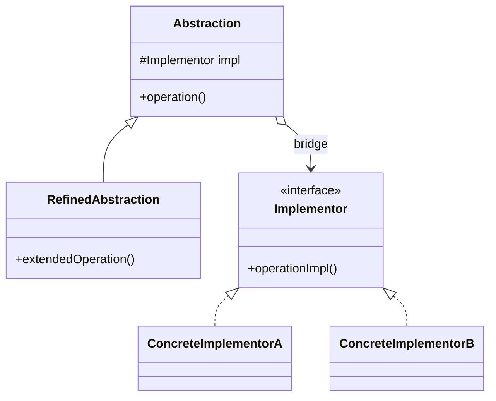
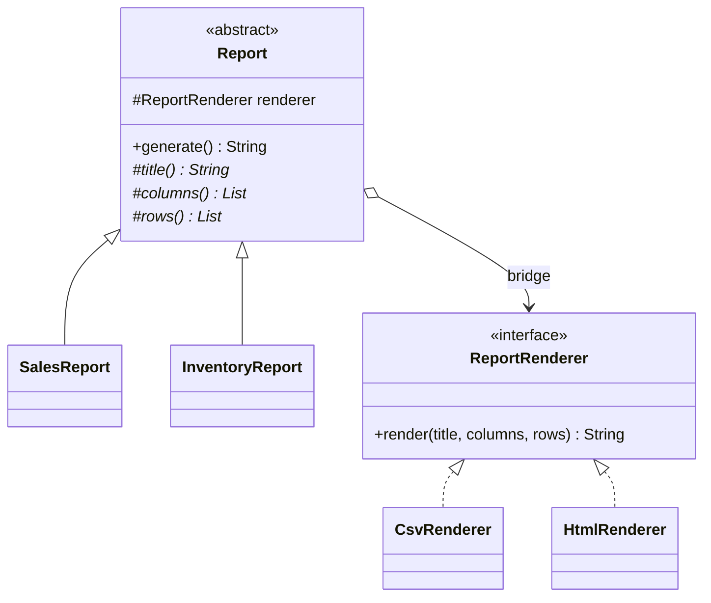
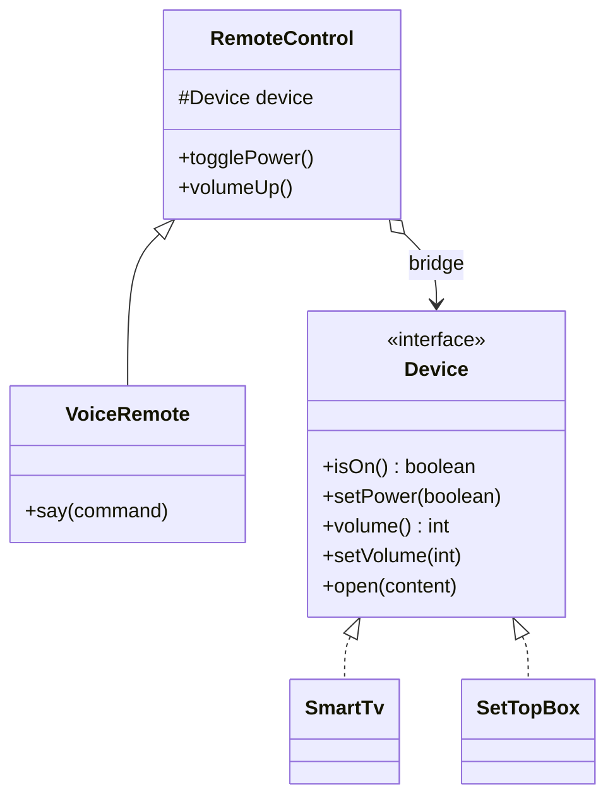
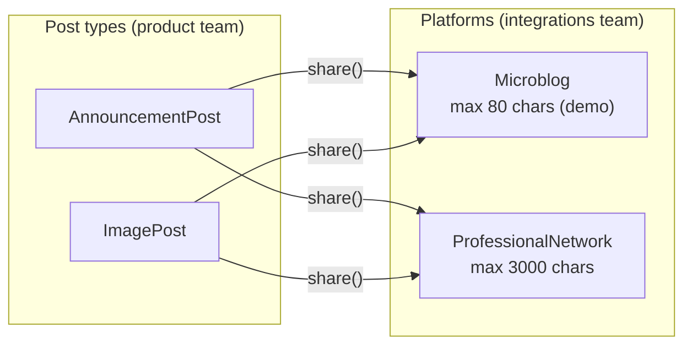

---
tags:
  - Structural
  - Intermediate
---

# Bridge

<span class="badge badge--intermediate">🟡 Intermediate</span>
<span class="badge badge--category">Structural</span>
<span class="badge badge--interview">Interview frequency ⭐⭐⭐</span>

!!! abstract "TL;DR"
    **Bridge splits a concept that varies in two independent directions into two hierarchies, connected by a reference ("the bridge").**
    Use it when you'd otherwise need a subclass for every combination (`SalesCsvReport`, `SalesHtmlReport`, `InventoryCsvReport`...).

---

## 1. Intent & Problem It Solves

**The problem in plain English:** an ERP has report types (sales, inventory, payroll...) and output formats (CSV, HTML, PDF...). With inheritance alone you write `SalesCsvReport`, `SalesHtmlReport`, `SalesPdfReport`, `InventoryCsvReport`... That's **reports × formats** classes. Add one format and you write one class *per report*. This is the "class explosion" problem.

**Formal definition (GoF):**
> Decouple an abstraction from its implementation so that the two can vary independently.

"Abstraction" here means the **high-level, client-facing hierarchy** (what a report contains), and "implementation" the **low-level hierarchy it delegates to** (how it's written out). It doesn't mean Java's `abstract` keyword.

## 2. Real-World Analogy

!!! example "Remote controls and devices"
    A TV remote, a voice remote and a phone app are different **controls**. A Smart TV, a set-top box and a soundbar are different **devices**. Any control can work with any device because they agree on a small protocol (power, volume, open content). Manufacturers develop remotes and devices independently, so you don't need a different remote model for every device model.

## 3. Structure



| Participant | Responsibility |
|---|---|
| **Abstraction** | High-level logic; holds a reference to an Implementor |
| **Refined Abstraction** | Variants of the high-level logic (`SalesReport`, `VoiceRemote`) |
| **Implementor** | Low-level primitive operations (`render`, `setVolume`) |
| **Concrete Implementor** | Platform-specific versions (`CsvRenderer`, `SmartTv`) |

With Bridge, the class count goes from **M × N** to **M + N**.

## 4. Naive Approach (Without the Pattern)

```java
class SalesCsvReport       { String generate() { /* sales data + CSV code  */ } }
class SalesHtmlReport      { String generate() { /* sales data + HTML code */ } }
class InventoryCsvReport   { String generate() { /* inventory + CSV code   */ } }
class InventoryHtmlReport  { String generate() { /* inventory + HTML code  */ } }
// Add PDF: 2 more classes. Add Payroll: 3 more classes. CSV escaping bug: fix it in N places.
```

- :material-close-circle:{ style="color:#e53935" } **Class explosion**: M × N classes.
- :material-close-circle:{ style="color:#e53935" } **Duplication**: CSV logic copied into every report.
- :material-close-circle:{ style="color:#e53935" } **Fixed at compile time**: you can't switch format at runtime.

---

## 5. Three Real-World Examples

### Example 1: ERP Reports × Output Formats (SaaS / ERP)

**Scenario:** An ERP (SAP-style) offers dozens of reports, and customers download them as CSV for Excel or view them as HTML in the browser; PDF and XLSX are on the roadmap. Report authors (finance and supply-chain teams) shouldn't need to know anything about formats, and the platform team should be able to add a format once for **all** reports. A CSV escaping bug (commas in product names) must be fixed in one place.

**Design:**



**Full Code:**

=== "Report.java"

    ```java
    --8<-- "code/structural/src/main/java/com/handbook/structural/bridge/reporting/Report.java"
    ```

    1.  **The bridge**: the abstraction holds the implementor through an interface, passed in at construction. Any report can be paired with any renderer at runtime.
    2.  The abstraction provides **what** (title, columns, rows) and delegates **how** to the renderer.

=== "SalesReport.java"

    ```java
    --8<-- "code/structural/src/main/java/com/handbook/structural/bridge/reporting/SalesReport.java"
    ```

=== "InventoryReport.java"

    ```java
    --8<-- "code/structural/src/main/java/com/handbook/structural/bridge/reporting/InventoryReport.java"
    ```

=== "Renderers"

    ```java
    --8<-- "code/structural/src/main/java/com/handbook/structural/bridge/reporting/ReportRenderer.java"
    ```

    ```java
    --8<-- "code/structural/src/main/java/com/handbook/structural/bridge/reporting/CsvRenderer.java"
    ```

    ```java
    --8<-- "code/structural/src/main/java/com/handbook/structural/bridge/reporting/HtmlRenderer.java"
    ```

=== "ReportingDemo.java"

    ```java
    --8<-- "code/structural/src/main/java/com/handbook/structural/bridge/reporting/ReportingDemo.java"
    ```

**Output:**

```text
--8<-- "code/outputs/structural/bridge/reporting/ReportingDemo.txt"
```

Note `"Basmati Rice, 5kg"`: the CSV escaping is written **once**, in `CsvRenderer`, and every report benefits.

**Why Bridge here:**

- Two dimensions (**report type** and **format**) that grow **independently**.
- **M + N** classes instead of M × N; a JSON format is a one-class change (the unit test adds one as a lambda).
- Each team owns its own hierarchy: report authors and the platform team don't step on each other.

---

### Example 2: Remotes × Devices (Streaming / Telecom)

**Scenario:** A telecom operator ships streaming to **Smart TVs** (its app) and its own **set-top boxes**. Customers control them with a **basic remote** or a **voice remote**. Devices differ in hardware (the set-top box's volume tops out at 30). Remote features (voice commands) are built by one team; device integrations by another. Every remote must work with every device.

**Design:**



**Full Code:**

=== "RemoteControl.java"

    ```java
    --8<-- "code/structural/src/main/java/com/handbook/structural/bridge/streaming/RemoteControl.java"
    ```

=== "VoiceRemote.java"

    ```java
    --8<-- "code/structural/src/main/java/com/handbook/structural/bridge/streaming/VoiceRemote.java"
    ```

=== "Device.java"

    ```java
    --8<-- "code/structural/src/main/java/com/handbook/structural/bridge/streaming/Device.java"
    ```

=== "Devices"

    ```java
    --8<-- "code/structural/src/main/java/com/handbook/structural/bridge/streaming/SmartTv.java"
    ```

    ```java
    --8<-- "code/structural/src/main/java/com/handbook/structural/bridge/streaming/SetTopBox.java"
    ```

=== "RemoteDemo.java"

    ```java
    --8<-- "code/structural/src/main/java/com/handbook/structural/bridge/streaming/RemoteDemo.java"
    ```

**Output:**

```text
--8<-- "code/outputs/structural/bridge/streaming/RemoteDemo.txt"
```

The voice remote's "louder" is built from the device's primitive `setVolume`, and the set-top box enforces its own limit of 30, so the remote doesn't need to know about it.

**Why Bridge here:**

- **Refined abstractions** (voice remote) add features using only **primitive device operations**.
- New devices (a soundbar) work with every existing remote immediately.
- This is the GoF's own example, in its modern form.

---

### Example 3: Post Types × Social Platforms (Social Media)

**Scenario:** A social-media scheduling tool (Buffer/Hootsuite-style) lets marketing teams write **announcements** and **image posts** once and publish them to several platforms. Each platform has its own API and limits: a microblog allows short text, a professional network allows 3,000 characters. Post types are added by the product team; platform integrations by the integrations team. The text must be trimmed to each platform's limit **automatically**.

**Design:**



**Full Code:**

=== "Post.java"

    ```java
    --8<-- "code/structural/src/main/java/com/handbook/structural/bridge/social/Post.java"
    ```

=== "Post types"

    ```java
    --8<-- "code/structural/src/main/java/com/handbook/structural/bridge/social/AnnouncementPost.java"
    ```

    ```java
    --8<-- "code/structural/src/main/java/com/handbook/structural/bridge/social/ImagePost.java"
    ```

=== "Platforms"

    ```java
    --8<-- "code/structural/src/main/java/com/handbook/structural/bridge/social/SocialPlatform.java"
    ```

    ```java
    --8<-- "code/structural/src/main/java/com/handbook/structural/bridge/social/Microblog.java"
    ```

    ```java
    --8<-- "code/structural/src/main/java/com/handbook/structural/bridge/social/ProfessionalNetwork.java"
    ```

=== "SocialDemo.java"

    ```java
    --8<-- "code/structural/src/main/java/com/handbook/structural/bridge/social/SocialDemo.java"
    ```

**Output:**

```text
--8<-- "code/outputs/structural/bridge/social/SocialDemo.txt"
```

The same announcement is 97 characters on the professional network and trimmed to 80 on the microblog, without the post classes knowing either limit.

**Why Bridge here:**

- Post types and platforms change on **different schedules** and are owned by **different teams**.
- The abstraction (`Post.share()`) adapts to each implementor's capabilities (`maxLength()`) through the bridge.
- A new platform is one class; every post type works with it on day one.

---

??? example "Unit Tests: `BridgeTest.java` (all three examples)"

    ```java
    --8<-- "code/structural/src/test/java/com/handbook/structural/bridge/BridgeTest.java"
    ```

## 6. Variations & Modern Java Take

- **Implementor as a functional interface.** When the implementor has one method (`ReportRenderer`), a **lambda** is a full implementor, as the unit test's JSON renderer shows.
- **Choose the implementor with DI.** In Spring, inject the implementor (`@Qualifier("csv") ReportRenderer`) or pick one per request (`?format=csv`) from a map of beans.
- **Composition over inheritance.** Bridge is the GoF's clearest example of this principle: instead of growing one hierarchy in two directions, you **compose** two hierarchies.
- **Bridge + Abstract Factory.** An abstract factory can create the right implementor for the platform (for example, the device driver family).

## 7. Where It Lives in Real Frameworks

| Where | Abstraction | Implementor |
|---|---|---|
| **JDBC** | `DriverManager`, `Connection`, `Statement` API your code uses | Vendor drivers (PostgreSQL, MySQL, Oracle) |
| **SLF4J** | `Logger` API | Logback, Log4j2, JUL back-ends |
| **JDK AWT** | `java.awt.Component` (Button, Window) | Platform "peers" per OS |
| **JDK** | `java.util.logging.Handler` | `Formatter` (`SimpleFormatter`, `XMLFormatter`), so any handler can use any format |
| **Spring** | `JdbcTemplate`, `RestClient` | `DataSource`, `ClientHttpRequestFactory` (JDK, Apache, Jetty, Reactor clients) |
| **Spring Data** | `Repository` abstractions | Store-specific modules (JPA, MongoDB, Redis) |

## 8. Pros, Cons & Trade-offs

| ✅ Pros | ❌ Cons |
|---|---|
| **M + N** classes instead of M × N | More up-front design; abstract when you only have one dimension |
| Abstraction and implementation **evolve independently** | Harder to understand for newcomers (two hierarchies, one indirection) |
| **Swap implementations at runtime** | The implementor interface must be **stable and general** enough for every abstraction, which is hard to get right |
| Hides platform details from client code | Over-engineering if the second dimension never appears |

## 9. Pitfalls & Anti-Patterns

!!! danger "A leaky implementor interface"
    If `Device` grows `setHdmiCecMode()` because one TV needs it, every other device must fake it. Keep the implementor to **primitives** that all platforms support, and let refined abstractions build features from them.

!!! warning "Bridge for a single dimension"
    One report, three formats? That's just **Strategy** (inject a renderer). Bridge pays off when **both** sides have variants.

!!! warning "Mixing it up with Adapter"
    Adapter is applied **after** the fact to make two existing things fit. Bridge is designed **up front** so two hierarchies can grow apart.

## 10. Senior / Architect Deep Dive (10–15 yrs)

**Bridge at architecture scale.** Driver models (JDBC, SLF4J, cloud provider SDK "core + provider"), plug-in back-ends (storage engines in databases, rendering back-ends in game engines) and multi-platform UIs are all Bridges. The key design work is the **implementor interface**: small, stable, versioned, and with a **capabilities query** (`maxLength()`, `supportsTransactions()`) so the abstraction can adapt instead of failing.

**Capability negotiation.** Example 3's `maxLength()` is a simple version of capability negotiation. In larger systems, implementors expose a capability set (`Set<Feature>`), and the abstraction degrades gracefully (no image support, so post a link).

**Testing.** Test the abstraction with a **fake implementor** (records calls) and test each implementor with a **shared contract test** (every renderer escapes special characters; every device clamps volume).

**Bridge vs. Strategy, honestly.** Structurally they're nearly identical (an object delegating to an interface). The difference is **intent and scale**: Strategy swaps an **algorithm** for one context; Bridge separates **two whole hierarchies** that both keep growing. In interviews, saying that clearly is worth more than a diagram.

!!! bug "War story: 54 notification classes"
    A fintech's notification module started with `OtpSms` and `OtpEmail`. Two years later it had 9 notification types × 6 channels = **54 classes**, each with copied formatting and retry code. A WhatsApp channel meant 9 new classes; a retry bug had to be fixed 54 times (they found 51).
    **Fix:** split into `Notification` (abstraction: what to say, with refined types) and `Channel` (implementor: send, with capability flags like `supportsRichText`). 54 classes became 15; retries moved into a single channel decorator.
    **Lesson:** when class names are **two nouns glued together** (`OtpSms`, `SalesCsv`), look for a Bridge.

## 11. Related Patterns & Comparisons

| | Bridge | Strategy | Adapter | Abstract Factory |
|---|---|---|---|---|
| Intent | Let **two hierarchies** vary independently | Swap **one algorithm** | Make incompatible interfaces fit | Create a family of matching objects |
| When designed | Up front | Up front | After the fact | Up front |
| Structure | Abstraction **has-a** implementor; both sides subclassed | Context **has-a** strategy | Adapter **has-a** adaptee | Factory creates products |

## 12. Interview Corner

=== "🟢 Beginner / Service Companies"

    **Q1. What is the Bridge pattern?**

    A structural pattern that **separates an abstraction from its implementation** so both can **vary independently**. The abstraction holds a **reference** to the implementor; that reference is the "bridge".

    **Q2. What problem does it solve?**

    **Class explosion** from combining two dimensions with inheritance (M × N classes become M + N).

    **Q3. Give an example.**

    Shapes (Circle, Square) × renderers (SVG, ASCII), remotes × devices, reports × formats, and **JDBC** (your code uses the JDBC API; vendor drivers implement it).

    **Q4. Bridge vs. Adapter?**

    Bridge is **designed up front** to let two sides vary; Adapter is applied **afterwards** to make existing incompatible classes work together.

    **Q5. Which principle does Bridge follow?**

    **Composition over inheritance**, plus **Open/Closed** (add an implementor without touching abstractions) and **Single Responsibility**.

=== "🟡 Mid-Level"

    **Q1. Bridge vs. Strategy?**

    Similar structure; different intent. **Strategy** swaps an algorithm inside one class. **Bridge** splits **two hierarchies** that both get subclassed and evolve independently.

    **Q2. How do you choose the implementor at runtime?**

    Pass it into the abstraction's constructor (DI), or look it up from a map by a request parameter (`format=csv`).

    **Q3. How do you design the implementor interface?**

    Keep it to **primitive operations** every implementation can support; build richer behavior in refined abstractions; add **capability queries** for optional features.

    **Q4. How do you test a Bridge?**

    Abstractions with a **fake implementor** (or a lambda); implementors with a **shared contract test** that every implementation must pass.

    **Q5. How is JDBC a Bridge?**

    The **abstraction** is the JDBC API (`Connection`, `Statement`, `ResultSet`) your code uses; the **implementors** are vendor drivers. Your DAO code works with any database driver, and drivers evolve without changing your code.

=== "🔴 Senior / FAANG / SAP"

    **Q1. "Design a notification platform: 10 message types, 6 channels, more of both every year."**

    **Bridge**: `Notification` (type: content, priority, templates) × `Channel` (SMS, email, push, WhatsApp; send, capabilities). Add **decorators** on channels (retries, rate limits, metrics), **fallback chains** (push fails, so SMS), **user preferences**, **idempotency keys**, and per-channel **queues** for isolation.

    **Q2. "How would you design a storage abstraction over S3, GCS and local disk?"**

    The abstraction (`BlobStore` with higher-level operations like `putWithChecksum`, `copy`, `listByPrefix`) uses a **small implementor SPI** (put, get, list, delete, with capability flags such as multipart support). Contract tests per backend; consistency differences documented; cost and latency metrics per backend.

    **Q3. "The implementor interface needs a new method. How do you evolve it across 12 implementations?"**

    Add it as a **default method** (fallback built from existing primitives, or a capability flag that reports "unsupported"); roll out implementations gradually; then make it required. Version the SPI if third parties implement it.

    **Q4. "When is Bridge over-engineering?"**

    When there's only **one** real dimension or one implementation, or when the second dimension is speculative. Start with Strategy or a single class and refactor to a Bridge when the second axis is real.

    **Q5. "Where else does this appear at system level?"**

    **Driver models** (JDBC, ODBC), **logging facades** (SLF4J + back-ends), **cross-platform UI** frameworks (one widget API, native renderers), **observability** (OpenTelemetry API + exporters).

=== "💻 Coding Challenge"

    **Problem:** You have `Circle` and `Square`, and two renderers: SVG and ASCII. Design it so a new shape **or** a new renderer is a single new class, and show all four combinations.

    ??? success "Solution"

        === "Renderer.java"

            ```java
            --8<-- "code/structural/src/main/java/com/handbook/structural/bridge/shapes/Renderer.java"
            ```

        === "Shapes.java"

            ```java
            --8<-- "code/structural/src/main/java/com/handbook/structural/bridge/shapes/Shapes.java"
            ```

        === "ShapesDemo.java"

            ```java
            --8<-- "code/structural/src/main/java/com/handbook/structural/bridge/shapes/ShapesDemo.java"
            ```

        **Output:**

        ```text
        --8<-- "code/outputs/structural/bridge/shapes/ShapesDemo.txt"
        ```

        **Key points to say:** shapes know **what** they are; renderers know **how** to draw primitives. 2 shapes + 2 renderers = 4 classes for 4 combinations; a `Triangle` or a `CanvasRenderer` is one more class each. (Adding a *shape* also means adding a primitive to `Renderer`, which is the trade-off of a Bridge whose implementor has one method per shape. Mention it.)

!!! info "Behavioural tie-in (STAR) for experienced candidates"
    - **S:** Our notifications code had grown to 54 classes (types × channels) with copy-pasted retry logic.
    - **T:** Add WhatsApp without 9 more classes, and fix retries once.
    - **A:** Refactored to a Bridge (notification types × channels), moved retries into a channel decorator, and added a contract test every channel must pass.
    - **R:** 15 classes instead of 54; WhatsApp shipped as one class in 4 days; retry-related incidents dropped to zero.

## 13. Quick Revision Card

!!! tip "Remember in 30 seconds"
    - **Two dimensions that vary independently** become **two hierarchies** joined by a reference.
    - Fixes **class explosion**: M × N becomes M + N.
    - **Abstraction** = what (high level); **implementor** = how (primitives).
    - **vs Strategy:** two growing hierarchies vs. one swappable algorithm. **vs Adapter:** up front vs. after the fact.
    - **Real life:** JDBC, SLF4J, AWT peers, `Handler` + `Formatter`.

    ```java
    abstract class Report { protected final ReportRenderer renderer; String generate() { return renderer.render(title(), columns(), rows()); } }
    ```

## Practice

- [ ] Add a `MarkdownRenderer` and a `PayrollReport`; count how many classes you touched.
- [ ] Add a `Soundbar` device that has no `open(content)` support, and design a capability check.
- [ ] Add a `supportsImages()` capability to `SocialPlatform` and degrade `ImagePost` to a link when it's false.

---

[:material-arrow-left: Adapter](adapter.md){ .md-button }
[Next: Composite :material-arrow-right:](composite.md){ .md-button .md-button--primary }
