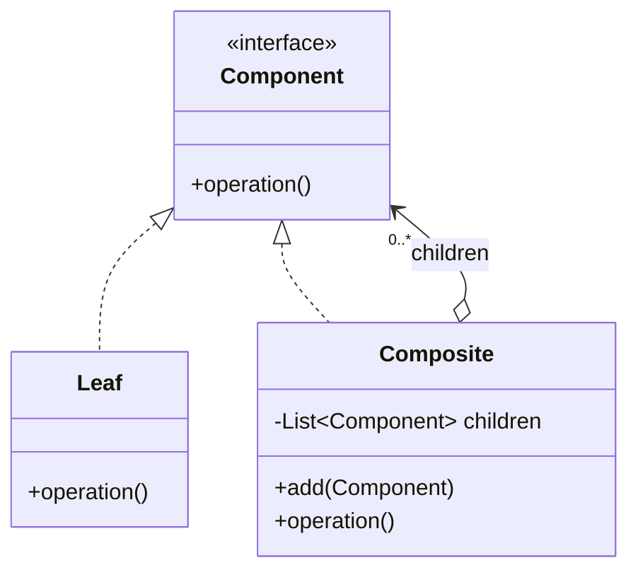
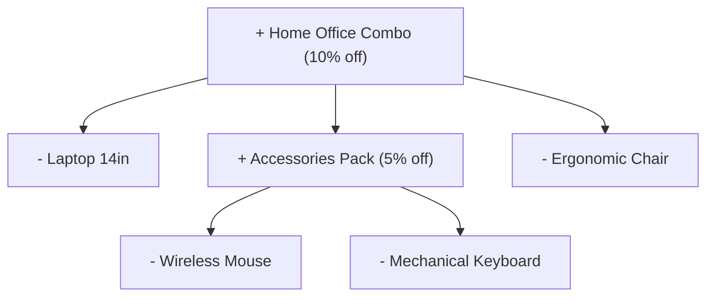
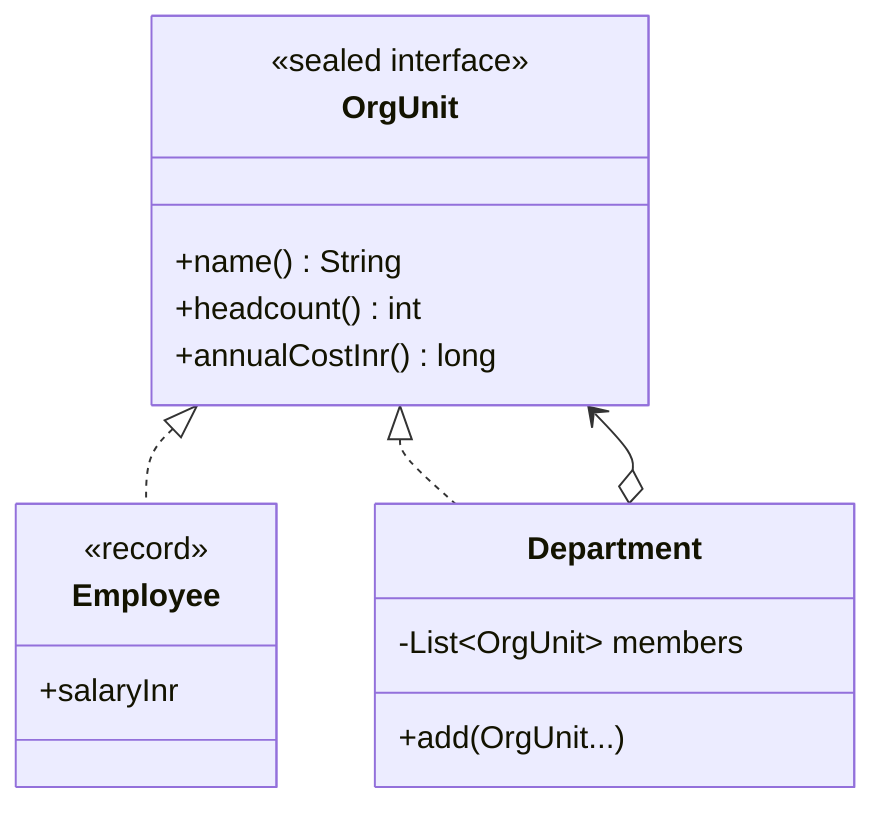
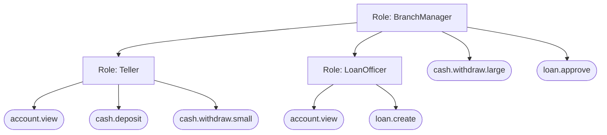

---
tags:
  - Structural
  - Intermediate
---

# Composite

<span class="badge badge--intermediate">🟢 Beginner → 🟡 Intermediate</span>
<span class="badge badge--category">Structural</span>
<span class="badge badge--interview">Interview frequency ⭐⭐⭐⭐</span>

!!! abstract "TL;DR"
    **Composite lets you build trees of objects and treat a single object and a whole group of objects in exactly the same way.**
    Use it for part–whole hierarchies: bundles of products, departments of employees, roles of permissions, folders of files, UI components.

---

## 1. Intent & Problem It Solves

**The problem in plain English:** a shop sells products, but also bundles, and bundles can contain other bundles. The cart wants to ask "what's your price?" without caring whether it's holding a mouse or a "Home Office Combo" with a nested "Accessories Pack". Without Composite, every caller needs `if (item instanceof Bundle) { loop... recurse... }`.

**Formal definition (GoF):**
> Compose objects into tree structures to represent part-whole hierarchies. Composite lets clients treat individual objects and compositions of objects uniformly.

## 2. Real-World Analogy

!!! example "An army's chain of command"
    A general orders "advance". The order goes to divisions, which pass it to brigades, then platoons, then individual soldiers. The general doesn't care whether "Division 3" is one person or ten thousand: they give the same order to a unit and the unit handles its own members.

## 3. Structure



| Participant | Responsibility |
|---|---|
| **Component** | The common interface (`priceInr()`, `headcount()`, `grants()`) |
| **Leaf** | An individual object with no children (`Product`, `Employee`, `Permission`) |
| **Composite** | Holds children (leaves **or** composites) and implements the operation by **delegating to them and combining the results** |
| **Client** | Works with `Component` only |

## 4. Naive Approach (Without the Pattern)

```java
int price(Object item) {
    if (item instanceof Product p) return p.getPrice();
    if (item instanceof Bundle b) {
        int sum = 0;
        for (Object child : b.getItems()) sum += price(child);   // recursion lives in the CLIENT
        return sum - sum * b.getDiscount() / 100;
    }
    throw new IllegalArgumentException();
}
// ...and the same type checks again in describe(), weight(), taxCategory(), isInStock()...
```

- :material-close-circle:{ style="color:#e53935" } **Type checks and recursion in every client.**
- :material-close-circle:{ style="color:#e53935" } A new node type (gift card) means editing every one of those methods.

---

## 5. Three Real-World Examples

### Example 1: Nested Product Bundles (E-commerce)

**Scenario:** An electronics marketplace sells "Home Office Combo" bundles at 10% off, and a bundle can contain another bundle (an "Accessories Pack" at 5% off). Discounts apply **at each level**. Cart, checkout, invoices and recommendations all need the price of "an item" without special-casing bundles, and merchandisers create new bundles from the admin UI every week.

**Design:**



**Full Code:**

=== "Bundle.java"

    ```java
    --8<-- "code/structural/src/main/java/com/handbook/structural/composite/ecommerce/Bundle.java"
    ```

    1.  Children are typed as the **component interface**, so a bundle can hold products *and* bundles.
    2.  The composite **delegates to its children and combines** their results. Recursion happens naturally: a child bundle computes its own discounted price first.
    3.  Same idea for display: each level indents its children.

=== "CatalogItem.java"

    ```java
    --8<-- "code/structural/src/main/java/com/handbook/structural/composite/ecommerce/CatalogItem.java"
    ```

=== "Product.java"

    ```java
    --8<-- "code/structural/src/main/java/com/handbook/structural/composite/ecommerce/Product.java"
    ```

=== "BundleDemo.java"

    ```java
    --8<-- "code/structural/src/main/java/com/handbook/structural/composite/ecommerce/BundleDemo.java"
    ```

**Output:**

```text
--8<-- "code/outputs/structural/composite/ecommerce/BundleDemo.txt"
```

The cart loop treats the 5-product bundle and the single cable identically.

**Why Composite here:**

- Bundles are a **part–whole tree** of arbitrary depth.
- Clients call `priceInr()` on anything. **No `instanceof`, no recursion in client code**.
- `sealed` lists the node types, so the compiler knows every kind of `CatalogItem`.

---

### Example 2: Org Chart Cost Roll-up (HR SaaS)

**Scenario:** An HR and finance SaaS shows managers their org's **headcount and annual salary cost**, rolled up through any depth of departments and teams. Finance asks questions like "what share of Engineering's budget is the Payments team?". Re-orgs happen quarterly, so the tree is data, not code.

**Design:**



**Full Code:**

=== "OrgUnit.java"

    ```java
    --8<-- "code/structural/src/main/java/com/handbook/structural/composite/org/OrgUnit.java"
    ```

    1.  With a `sealed` component, Java 21 **pattern matching for `switch`** can replace a polymorphic `print()` method. The switch is exhaustive with no `default`, so a new node type is a compile error here. Use methods for core behavior, and pattern matching for operations that don't belong on the nodes (rendering, export).

=== "OrgChartDemo.java"

    ```java
    --8<-- "code/structural/src/main/java/com/handbook/structural/composite/org/OrgChartDemo.java"
    ```

**Output:**

```text
--8<-- "code/outputs/structural/composite/org/OrgChartDemo.txt"
```

**Why Composite here:**

- An org is a textbook **part–whole hierarchy**: a department contains employees and departments.
- **Roll-ups** (headcount, cost) are written once and work at every level.
- Records for leaves + a sealed interface keep the model small and safe.

---

### Example 3: Nested Roles and Permissions (Banking)

**Scenario:** A core banking system controls who can do what. A **Teller** can view accounts, take deposits and make small withdrawals. A **Branch Manager** includes everything a Teller and a Loan Officer can do, plus large withdrawals and loan approvals. Security asks two questions: "can this user do X?" (checked on every request) and "list everything this role allows" (for audits). Roles must **never** include themselves through a chain, which would cause infinite recursion in production.

**Design:**



**Full Code:**

=== "Role.java"

    ```java
    --8<-- "code/structural/src/main/java/com/handbook/structural/composite/banking/Role.java"
    ```

    1.  **Cycle protection.** A tree must stay a tree. If Teller included BranchManager, which includes Teller, `grants()` would recurse forever. Reject cycles when the tree is built, not when it's used.
    2.  `anyMatch` **short-circuits**: it stops at the first child that grants the permission.

=== "AccessRight.java"

    ```java
    --8<-- "code/structural/src/main/java/com/handbook/structural/composite/banking/AccessRight.java"
    ```

=== "Permission.java"

    ```java
    --8<-- "code/structural/src/main/java/com/handbook/structural/composite/banking/Permission.java"
    ```

=== "AccessDemo.java"

    ```java
    --8<-- "code/structural/src/main/java/com/handbook/structural/composite/banking/AccessDemo.java"
    ```

**Output:**

```text
--8<-- "code/outputs/structural/composite/banking/AccessDemo.txt"
```

**Why Composite here:**

- Roles **contain permissions and roles**: the same interface answers "does it grant X?" at any level.
- Two different operations, **search** (`grants`) and **collect** (`collect`), both follow the tree naturally.
- Shows the production concern most tutorials skip: **cycles**.

---

??? example "Unit Tests: `CompositeTest.java` (all three examples + challenge)"

    ```java
    --8<-- "code/structural/src/test/java/com/handbook/structural/composite/CompositeTest.java"
    ```

## 6. Variations & Modern Java Take

**Where do `add`/`remove` live? (Transparency vs. safety)**

| Option | Pros | Cons |
|---|---|---|
| On the **Component** (GoF "transparent") | Clients treat everything the same, even for building | Leaves must throw on `add()`, which fails at runtime |
| On the **Composite** only ("safe"), as in all examples here | Compiler stops you adding children to a leaf | Builders must know they hold a composite |

Modern Java leans to **safe**: `sealed` interfaces + records for leaves + pattern matching where needed.

**Other variations:**

- **Parent references** for walking upward (breadcrumbs, "which department is this person in?"). Keep them consistent when moving nodes.
- **Caching** expensive aggregates (cost of a huge org) and invalidating up the tree on change.
- **Iteration** with an external iterator (depth-first, breadth-first) or a **Visitor** for many different operations over the same tree.
- **Immutable trees** built with builders, safe to share between threads.

## 7. Where It Lives in Real Frameworks

| Where | Composite | Leaf |
|---|---|---|
| JDK AWT/Swing | `Container` (`JPanel`, `JFrame`) | `JButton`, `JLabel` |
| JavaFX | `Parent` / `Group` | `Node` leaves (`Text`, `Shape`) |
| DOM / XML | `Element` with child `Node`s | `Text` nodes |
| JDK NIO | Directories in `Files.walk()` | Regular files |
| Spring | `CompositeCacheManager`, `CompositePropertySource`, `CompositeHealthContributor` (Actuator) | Individual managers, sources, health indicators |
| Spring Security | Role hierarchies (`RoleHierarchyImpl`: `ROLE_ADMIN > ROLE_USER`) | Authorities |
| JUnit 5 | Test containers (classes, `@Nested`) | Test methods |

## 8. Pros, Cons & Trade-offs

| ✅ Pros | ❌ Cons |
|---|---|
| Clients treat single items and groups **uniformly** | Hard to **restrict** what a composite can contain (a "Bundle that only contains electronics") with types alone |
| New node types without changing clients (**OCP**) | Generic interfaces can be **too general** for some leaves |
| Recursive operations are **natural and short** | Deep trees can mean **deep recursion** (stack overflow) and slow roll-ups |
| Matches how the domain is described ("contains") | Cycles, if you allow arbitrary graphs |

## 9. Pitfalls & Anti-Patterns

!!! danger "Cycles"
    A node that (indirectly) contains itself makes recursive operations loop forever. Validate on insert (Example 3) or detect with a visited set.

!!! danger "Very deep trees and recursion"
    A user-built hierarchy 10,000 levels deep can overflow the stack. Limit depth, or use an explicit stack (iterative traversal) for operations on untrusted trees.

!!! warning "Expensive roll-ups on every call"
    Recomputing the cost of a 50,000-person org on every page view is slow. Cache aggregates per node and invalidate on change, or pre-compute in the database (materialized path, closure tables).

!!! warning "Forcing a hierarchy that isn't one"
    If items can belong to **several** parents (a product in many bundles is fine; a department reporting to two VPs isn't a tree), you have a graph. Model it as one.

## 10. Senior / Architect Deep Dive (10–15 yrs)

**Trees in databases.** Composites in memory usually come from relational or document stores. Know the options: **adjacency list** (`parent_id`, simple, recursive CTE queries), **materialized path** (`/1/4/9/`, fast subtree reads), **nested sets** (fast reads, slow writes), **closure table** (all ancestor–descendant pairs, flexible and fast, more storage). Interviewers at product companies love this follow-up.

**Authorization at scale.** Example 3 is a mini RBAC. Real systems flatten role trees into **effective permission sets** (cached per user, invalidated on role change) because `grants()` runs on every request. Some move to relationship-based access control (Google Zanzibar style: OpenFGA, SpiceDB), which generalizes the tree to a graph.

**Composite + Visitor + Iterator.** When many unrelated operations run over the same stable tree (price, tax, export to PDF, validate), put the operations in **visitors** instead of growing the component interface. Java 21's **sealed + pattern matching** is often a lighter alternative to a classic Visitor (Example 2).

**Concurrency.** Shared, mutable trees need care: copy-on-write subtrees, or build immutable trees and swap the root atomically (`AtomicReference<Node>`).

!!! bug "War story: the role that included itself"
    An admin UI let customers build custom roles from other roles. One enterprise customer created "Ops" including "Support", then edited "Support" to include "Ops". The next login evaluated permissions recursively, hit a `StackOverflowError`, and the error was cached as "no permissions". Every user in that tenant was locked out on a Monday morning.
    **Fix:** cycle detection on save (with a clear error in the UI), an iterative permission resolver with a visited set as defence in depth, and effective-permission caching that never caches failures.
    **Lesson:** any tree editable by users is a graph until you prove otherwise.

## 11. Related Patterns & Comparisons

| | Composite | Decorator | Chain of Responsibility | Visitor |
|---|---|---|---|---|
| Shape | **Tree**: many children | **Chain**: one wrapped object | **Chain** of handlers | Operation over a structure |
| Purpose | Treat parts and wholes alike | Add behavior | Pass a request until handled | Add operations without changing nodes |
| Combines results? | Yes (sum, any, all) | Wraps one result | Usually one handler answers | Accumulates in the visitor |

**Often used with:** Iterator (traverse the tree), Visitor (operations on the tree), Builder (assemble trees), Flyweight (share identical leaves), Chain of Responsibility (events bubbling up parent links, as in UI frameworks).

## 12. Interview Corner

=== "🟢 Beginner / Service Companies"

    **Q1. What is the Composite pattern?**

    A structural pattern that composes objects into **tree structures** and lets clients **treat individual objects and groups uniformly** through a common interface.

    **Q2. Name the participants.**

    **Component** (common interface), **Leaf** (no children), **Composite** (holds children, delegates to them), and **Client**.

    **Q3. Give real examples.**

    File system (files and folders), UI (panels contain buttons and panels), org charts, product bundles, menus with sub-menus.

    **Q4. How does a composite compute something like total price?**

    It **iterates its children**, calls the same method on each (leaves return their value; composites recurse), and **combines** the results.

    **Q5. Which principle does it support?**

    **Open/Closed** (new node types without changing clients) and treating objects **polymorphically**.

=== "🟡 Mid-Level"

    **Q1. Should `add()` be in the Component interface?**

    It's a trade-off: on the component gives **transparency** (uniform API) but leaves must throw; on the composite only gives **type safety**. Modern Java usually prefers safety, with sealed types.

    **Q2. How do you prevent cycles?**

    Check on insert whether the new child already contains the parent (Example 3), or track a **visited set** during traversal.

    **Q3. How would you iterate a composite?**

    Recursively for small trees; an **explicit stack/queue** for deep or untrusted trees (DFS/BFS); or a **Visitor** for many operations.

    **Q4. How do you make roll-ups fast on large trees?**

    **Cache** aggregates per node and **invalidate** up the parent chain on changes, or pre-compute in storage.

    **Q5. Composite vs. Decorator?**

    Both use recursive composition, but a **decorator wraps one** object to add behavior, while a **composite holds many** children to represent a whole.

=== "🔴 Senior / FAANG / SAP"

    **Q1. "Design org-chart storage for a company with 500k employees and frequent re-orgs."**

    Compare **adjacency list + recursive CTE** (simple writes), **closure table** (fast subtree and ancestor queries; re-org updates many rows), **materialized path** (cheap reads, path rewrites on moves). Add **cached roll-ups** (headcount, cost) updated by events, **effective dating** (who reported to whom on a date), and access control on subtrees.

    **Q2. "Permission checks take 40 ms because of nested roles. Fix it."**

    Pre-compute **effective permissions** per role (flatten the tree), cache per user, invalidate on role or assignment changes via events; check with a set lookup (O(1)). Keep the tree for administration and audit only.

    **Q3. "How do you render a 1-million-node tree in a UI?"**

    Don't build it all: **lazy-load children** on expand, paginate large child lists, use **virtualized rendering**, and compute aggregates server-side.

    **Q4. "When does Composite become an anti-pattern?"**

    When the structure is really a **graph** (multiple parents), when leaves need very different interfaces (a forced common interface), or when trees get so deep that recursion and roll-ups hurt performance.

    **Q5. "Sealed interfaces + pattern matching vs. Visitor for operations on a composite?"**

    Since Java 21, **pattern matching over a sealed hierarchy** gives exhaustive, compile-checked type dispatch without accept/visit boilerplate. Use it for operations outside the model; keep **core behavior as methods** on the nodes. Classic Visitor still helps when operations need double dispatch or when the hierarchy isn't sealed.

=== "💻 Coding Challenge"

    **Problem:** Model a file system with files and folders. `sizeBytes()` on a folder returns the total size of everything inside it. Print the tree with sizes, children sorted by name, indented by depth.

    ??? success "Solution"

        === "Node.java"

            ```java
            --8<-- "code/structural/src/main/java/com/handbook/structural/composite/filesystem/Node.java"
            ```

        === "FileSystemDemo.java"

            ```java
            --8<-- "code/structural/src/main/java/com/handbook/structural/composite/filesystem/FileSystemDemo.java"
            ```

        **Output:**

        ```text
        --8<-- "code/outputs/structural/composite/filesystem/FileSystemDemo.txt"
        ```

        **Key points to say:** sealed abstract class with two final subclasses; folder size is the sum of children (recursive); sorting is done at print time so the model keeps insertion order; for real disks you'd cache folder sizes and handle symlink **cycles**.

!!! info "Behavioural tie-in (STAR) for experienced candidates"
    - **S:** A customer locked themselves out after building a circular custom role.
    - **T:** Restore access immediately and make it impossible to recur.
    - **A:** Hot-fixed the resolver to use an iterative traversal with a visited set, added cycle validation in the role editor, and flattened effective permissions into a per-user cache.
    - **R:** Access restored in 40 minutes; permission checks went from 12 ms to under 1 ms as a side effect.

## 13. Quick Revision Card

!!! tip "Remember in 30 seconds"
    - **Tree of parts and wholes**; leaves and composites share one interface.
    - The composite **delegates to its children and combines** results (sum, any, all).
    - **Safe vs. transparent**: put `add()` on the composite only (modern preference).
    - Watch for **cycles**, **deep recursion** and **slow roll-ups**.
    - **Real life:** Swing `Container`, DOM, file systems, Spring `Composite*` classes, role hierarchies.

    ```java
    int priceInr() { int sum = children.stream().mapToInt(CatalogItem::priceInr).sum(); return sum - sum * discount / 100; }
    ```

## Practice

- [ ] Add a `weightGrams()` operation to the catalog and see how many classes change.
- [ ] Rewrite `Role.grants` iteratively with a stack and a visited set.
- [ ] Add a parent reference to `OrgUnit.Department` and print an employee's reporting chain.
- [ ] Add a `GiftCard` leaf type to `CatalogItem` and follow the compiler errors.

---

[:material-arrow-left: Bridge](bridge.md){ .md-button }
[Next: Decorator :material-arrow-right:](decorator.md){ .md-button .md-button--primary }
