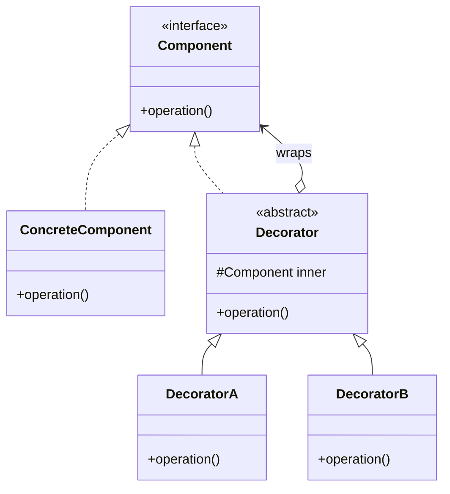
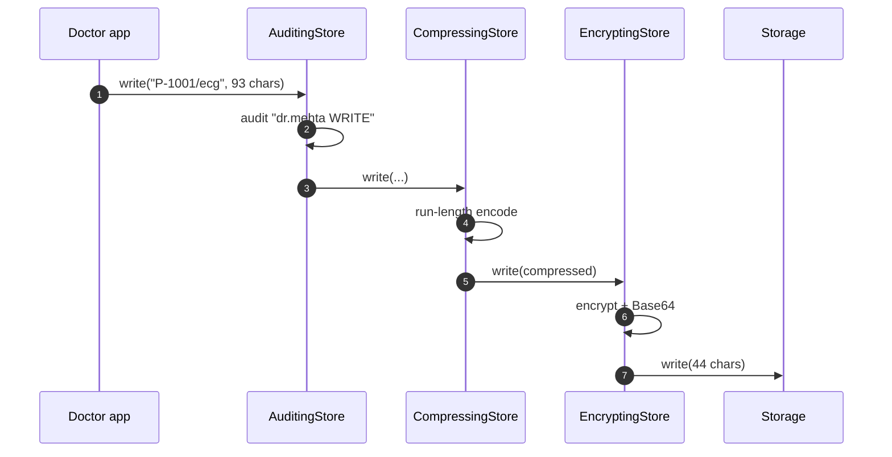

---
tags:
  - Structural
  - Intermediate
---

# Decorator

<span class="badge badge--intermediate">🟡 Intermediate</span>
<span class="badge badge--category">Structural</span>
<span class="badge badge--interview">Interview frequency ⭐⭐⭐⭐⭐</span>

!!! abstract "TL;DR"
    **Decorator wraps an object in another object with the same interface, adding behavior before or after delegating to it. Wrappers can be stacked.**
    Use it to add cross-cutting features (logging, retries, caching, encryption, pricing rules) without subclassing and without touching the original class.

---

## 1. Intent & Problem It Solves

**The problem in plain English:** a payment processor needs logging, retries and fraud checks, but not always all of them, and not always in the same order. Subclassing gives you `LoggingRetryingFraudCheckedProcessor`, `LoggingProcessor`, `RetryingFraudCheckedProcessor`... one subclass per combination. With decorators you write each feature **once** and **compose** them at runtime.

**Formal definition (GoF):**
> Attach additional responsibilities to an object dynamically. Decorators provide a flexible alternative to subclassing for extending functionality.

## 2. Real-World Analogy

!!! example "Dressing for the weather"
    You're still you. On a cold day you put on a sweater, then a jacket, then a raincoat. Each layer adds something (warmth, wind protection, waterproofing) and you can add or remove layers in any combination. Nobody needs to manufacture a "you-with-sweater-and-raincoat" person.

## 3. Structure



| Participant | Responsibility |
|---|---|
| **Component** | The interface clients use (`PaymentProcessor`) |
| **Concrete component** | The real work (`FlakyGatewayProcessor`) |
| **Decorator** | Implements Component **and holds** a Component; forwards by default |
| **Concrete decorators** | Add behavior before/after forwarding, or instead of it (`RetryingProcessor`, `FraudCheckProcessor`) |

The key trick: a decorator **is-a** Component **and has-a** Component, so decorators can wrap decorators.

## 4. Naive Approach (Without the Pattern)

```java
class PaymentProcessor { String pay(...) { /* gateway call */ } }
class LoggingPaymentProcessor extends PaymentProcessor { ... }
class RetryingPaymentProcessor extends PaymentProcessor { ... }
class LoggingRetryingPaymentProcessor extends RetryingPaymentProcessor { ... }       // logging copied
class FraudLoggingRetryingPaymentProcessor extends LoggingRetryingPaymentProcessor { ... }
// 3 features = up to 7 subclasses; a 4th feature doubles it. Order is fixed at compile time.
```

- :material-close-circle:{ style="color:#e53935" } **Subclass explosion** (2ⁿ combinations).
- :material-close-circle:{ style="color:#e53935" } **Fixed at compile time**: can't turn retries on for one merchant only.
- :material-close-circle:{ style="color:#e53935" } **Code duplication** of each feature across subclasses.

---

## 5. Three Real-World Examples

### Example 1: Stacking Payment Concerns (Payments)

**Scenario:** A payment gateway call sometimes times out under load. The payments team wants **fraud screening** (block orders above a limit before calling the gateway at all), **retries** (up to 3 attempts on timeouts), and **logging of every attempt** for incident analysis. Different merchants get different stacks (some have no fraud rule), so the composition must be decided at runtime, from configuration.

**Design:**


**Full Code:**

=== "PaymentDecorator.java"

    ```java
    --8<-- "code/structural/src/main/java/com/handbook/structural/decorator/payments/PaymentDecorator.java"
    ```

    1.  The decorator **implements** the interface and **holds** an instance of it. Because the field's type is the interface, it can hold the real processor or another decorator.

=== "FraudCheckProcessor.java"

    ```java
    --8<-- "code/structural/src/main/java/com/handbook/structural/decorator/payments/FraudCheckProcessor.java"
    ```

    1.  A decorator can **short-circuit**: it answers without calling `inner` at all. That's why fraud screening sits outermost: blocked orders never reach the gateway.

=== "RetryingProcessor.java"

    ```java
    --8<-- "code/structural/src/main/java/com/handbook/structural/decorator/payments/RetryingProcessor.java"
    ```

=== "LoggingProcessor.java"

    ```java
    --8<-- "code/structural/src/main/java/com/handbook/structural/decorator/payments/LoggingProcessor.java"
    ```

=== "Component"

    ```java
    --8<-- "code/structural/src/main/java/com/handbook/structural/decorator/payments/PaymentProcessor.java"
    ```

    ```java
    --8<-- "code/structural/src/main/java/com/handbook/structural/decorator/payments/FlakyGatewayProcessor.java"
    ```

=== "PaymentsDemo.java"

    ```java
    --8<-- "code/structural/src/main/java/com/handbook/structural/decorator/payments/PaymentsDemo.java"
    ```

**Output:**

```text
--8<-- "code/outputs/structural/decorator/payments/PaymentsDemo.txt"
```

Because logging sits **inside** the retry decorator, every attempt is logged. Put it outside and you'd see one log line per order. **Order is a design decision.**

**Why Decorator here:**

- Each concern is **one small class**, testable on its own.
- Stacks are **composed at runtime**, per merchant, from config.
- The checkout code sees only `PaymentProcessor`; it doesn't know what's stacked.

---

### Example 2: Patient Record Storage Pipeline (Healthcare)

**Scenario:** A hospital stores ECG traces and clinical notes in object storage. Regulations require **encryption at rest** and an **audit trail** of every read and write; ECG traces are long and repetitive, so **compression** cuts storage cost. Some record types (small notes) skip compression; test environments skip encryption. Each concern must be pluggable, and the order matters: **compress before encrypting**, because encrypted data looks random and doesn't compress.

**Design:**



**Full Code:**

=== "CompressingStore.java"

    ```java
    --8<-- "code/structural/src/main/java/com/handbook/structural/decorator/healthcare/CompressingStore.java"
    ```

=== "EncryptingStore.java"

    ```java
    --8<-- "code/structural/src/main/java/com/handbook/structural/decorator/healthcare/EncryptingStore.java"
    ```

=== "AuditingStore.java"

    ```java
    --8<-- "code/structural/src/main/java/com/handbook/structural/decorator/healthcare/AuditingStore.java"
    ```

=== "Component"

    ```java
    --8<-- "code/structural/src/main/java/com/handbook/structural/decorator/healthcare/RecordStore.java"
    ```

    ```java
    --8<-- "code/structural/src/main/java/com/handbook/structural/decorator/healthcare/InMemoryRecordStore.java"
    ```

=== "RecordsDemo.java"

    ```java
    --8<-- "code/structural/src/main/java/com/handbook/structural/decorator/healthcare/RecordsDemo.java"
    ```

**Output:**

```text
--8<-- "code/outputs/structural/decorator/healthcare/RecordsDemo.txt"
```

!!! warning "Toy algorithms on purpose"
    The run-length encoding and XOR cipher keep the output readable. In production use `GZIPOutputStream` (or Zstandard) and **AES-GCM** via `javax.crypto` with keys from a KMS. The structure stays exactly the same.

**Why Decorator here:**

- This is exactly how **`java.io`** works: `new GZIPOutputStream(new CipherOutputStream(new FileOutputStream(...)))`.
- Each concern is a separate, certifiable unit, which auditors like.
- **Bidirectional decorators**: `write` transforms on the way in, `read` reverses on the way out, in mirror order.

---

### Example 3: Pricing Rules (Grocery)

**Scenario:** A grocery app applies a member discount (10%), a festival offer (INR 100 off above INR 500) and GST (5%). Marketing changes the active rules weekly. Finance has one firm requirement: **GST is charged on the discounted price**. In an earlier version someone applied rules in the wrong order, and customers were charged INR 5 too much per order. Here each rule is a **functional decorator** built with Java default methods.

**Design:**


**Full Code:**

=== "PriceCalculator.java"

    ```java
    --8<-- "code/structural/src/main/java/com/handbook/structural/decorator/pricing/PriceCalculator.java"
    ```

    1.  Each `then...` default method returns a **new calculator that wraps `this`**: it calls the current pipeline, then applies its rule. That's a decorator written as a lambda, the functional-programming form of the pattern.

=== "PricingDemo.java"

    ```java
    --8<-- "code/structural/src/main/java/com/handbook/structural/decorator/pricing/PricingDemo.java"
    ```

**Output:**

```text
--8<-- "code/outputs/structural/decorator/pricing/PricingDemo.txt"
```

**Why Decorator here:**

- Rules are **independent, stackable, and reorderable**, and the order changes the result.
- Functional decorators (lambdas + default methods) remove the class boilerplate entirely.
- New rules (a bank-card offer) are one method; existing rules don't change.

---

??? example "Unit Tests: `DecoratorTest.java` (all three examples + challenge)"

    ```java
    --8<-- "code/structural/src/test/java/com/handbook/structural/decorator/DecoratorTest.java"
    ```

## 6. Variations & Modern Java Take

| Form | Example |
|---|---|
| **Classic class-based** with an abstract base decorator | Example 1 |
| **Direct implementation** (no base class) | Example 2: each decorator implements the interface and holds a field |
| **Functional** (lambdas, `Function.andThen`, default methods) | Example 3; also `UnaryOperator<String> pipeline = trim.andThen(lower)` |
| **Dynamic proxies / AOP** | Spring `@Transactional`, `@Cacheable`, `@Retryable`: decorators generated at runtime |
| **Resilience4j** | `Decorators.ofSupplier(call).withRetry(..).withCircuitBreaker(..).withBulkhead(..).decorate()` |

**Decorators and Spring.** Spring AOP proxies are decorators: `@Transactional` wraps your bean with "begin, call, commit or roll back". You can also write decorators manually with `@Primary` beans that take the original bean as a constructor argument.

**Equality and identity.** A decorated object is a **different object**. `decorated.equals(original)` is usually false, and `instanceof ConcreteComponent` fails on the wrapper. Don't rely on concrete types once you decorate.

## 7. Where It Lives in Real Frameworks

| Where | Example |
|---|---|
| **`java.io`** | `BufferedInputStream`, `DataInputStream`, `GZIPInputStream`, `CipherInputStream` all wrap an `InputStream`; same for readers and writers |
| JDK collections | `Collections.unmodifiableList`, `synchronizedMap`, `checkedList` wrap collections |
| Servlet API | `HttpServletRequestWrapper`, `HttpServletResponseWrapper` |
| Spring | `TransactionAwareDataSourceProxy`, `LazyConnectionDataSourceProxy`; `BeanPostProcessor`s that wrap beans; AOP proxies |
| Spring Session | Wraps `HttpSession` |
| Resilience4j / Micrometer | Retry, circuit breaker, timer decorators around calls |
| Caffeine / Spring Cache | `@Cacheable` and cache-loading wrappers |

## 8. Pros, Cons & Trade-offs

| ✅ Pros | ❌ Cons |
|---|---|
| Add behavior **without modifying** the class (OCP) | **Many small objects**; stack traces get deep |
| **Combine features at runtime** in any order | **Order matters** and is easy to get wrong |
| Each concern in **one class** (SRP), testable on its own | Removing a decorator from the middle of a stack is awkward |
| Avoids 2ⁿ subclasses | Identity and `instanceof` checks break on wrapped objects |
| | Big interfaces mean every decorator must forward every method (use a base class) |

## 9. Pitfalls & Anti-Patterns

!!! danger "Wrong order"
    Encrypt-then-compress (no compression), retry-outside-circuit-breaker (retries hammer an open circuit), tax-before-discount (wrong prices). Write down the intended order and test it (see `pricingOrderMatters`).

!!! danger "Retrying non-idempotent operations"
    A retry decorator around "charge card" can double-charge. Retry only idempotent calls, or send an **idempotency key**.

!!! warning "Forgetting to forward some methods"
    In interfaces with many methods, a decorator that only overrides one and forgets the others breaks behavior silently. Extend a **forwarding base class** that delegates everything.

!!! warning "Decorators with hidden state"
    A caching decorator that never evicts is a memory leak; a retry decorator with a shared counter isn't thread-safe. Decorators are real components; give them the same care.

## 10. Senior / Architect Deep Dive (10–15 yrs)

**Resilience stacks are decorator stacks, and the order is documented.** Resilience4j's recommended order (outermost to innermost) is roughly: `Retry ( CircuitBreaker ( RateLimiter ( TimeLimiter ( Bulkhead ( call ) ) ) ) )`. Reasoning: retries should see the circuit breaker's "open" error and stop; time limits apply per attempt; the bulkhead limits concurrent calls. Be ready to defend whichever order you choose.

**Decorators vs. AOP vs. middleware.** All three wrap behavior around calls. Use **explicit decorators** when the composition is part of the domain (pricing rules) or changes per tenant; use **AOP** for uniform infrastructure (transactions, metrics) across many beans; use **middleware/filters** (servlet filters, gateway filters) at process or network boundaries.

**Observability.** With deep stacks, name each layer in logs and metrics (`payment.retry.attempts`, `payment.fraud.blocked`) so you can tell which layer acted.

**Performance.** Each layer is a virtual call; the JIT usually inlines small, monomorphic stacks. Deep or megamorphic stacks (many decorator types at one call site) can hurt hot paths. Measure before collapsing layers.

!!! bug "War story: the retry that DDoS'ed our own database"
    A team added a retry decorator (5 attempts, no backoff) around a repository call, then a second team added a retry decorator at the service layer (3 attempts), and an HTTP client retried too (3 attempts). When the database slowed down, each user request turned into up to **45 queries**. The slowdown became an outage.
    **Fix:** one retry layer only (at the edge), exponential backoff with jitter, a retry budget, and a circuit breaker **inside** the retry so retries stop when the database is clearly down.
    **Lesson:** decorators compose multiplicatively. Draw the whole stack before adding a layer.

## 11. Related Patterns & Comparisons

| | Decorator | Proxy | Adapter | Composite | Chain of Responsibility |
|---|---|---|---|---|---|
| Interface | **Same** as wrapped | **Same** as subject | **Different** | Same as children | Same handler interface |
| Purpose | **Add behavior** | **Control access** (lazy, remote, security, cache) | Make it fit | Part-whole trees | Pass the request along until handled |
| Who creates the wrapper? | The **client** composes stacks | Usually the framework or factory, hidden from the client | Integration code | Tree builder | Pipeline setup |
| Calls the inner object? | Almost always | Maybe (may deny or defer) | Always (translated) | Calls all children | Handlers may stop the chain |

## 12. Interview Corner

=== "🟢 Beginner / Service Companies"

    **Q1. What is the Decorator pattern?**

    A structural pattern that **adds responsibilities to an object dynamically** by wrapping it in an object of the **same interface**. Decorators can be **stacked**.

    **Q2. Give a Java example.**

    **Java I/O**: `new BufferedReader(new InputStreamReader(new FileInputStream("a.txt")))`. Each wrapper adds a feature (buffering, decoding) to the stream it wraps.

    **Q3. Why not just use inheritance?**

    Inheritance is **static** and leads to a **subclass for every combination**. Decorators are composed at **runtime**, in any combination, with one class per feature.

    **Q4. Decorator vs. Proxy?**

    Same structure; different intent. Decorator **adds behavior**; Proxy **controls access** (lazy loading, security, remote calls, caching).

    **Q5. Which principle does Decorator follow?**

    **Open/Closed** (extend without modifying) and **Single Responsibility** (each decorator does one thing).

=== "🟡 Mid-Level"

    **Q1. Does the order of decorators matter?**

    **Yes**: compress before encrypting, logging inside or outside retry, discounts before tax. Order changes behavior and results.

    **Q2. How does Spring use decorators?**

    **AOP proxies** wrap beans for `@Transactional`, `@Cacheable`, `@Async`, `@Retryable`. Also `BeanPostProcessor`s that wrap beans, and `HttpServletRequestWrapper` in filters.

    **Q3. How do you write a decorator for an interface with 20 methods?**

    Extend an abstract **forwarding** base class that delegates all 20 by default; override only what you change.

    **Q4. How do you test decorators?**

    Each one in isolation with a **fake inner component** (assert it adds its behavior and forwards correctly), plus one test for the **composed stack's order**.

    **Q5. Write a functional decorator.**

    `Function<String,String> pipeline = String::trim; pipeline = pipeline.andThen(String::toLowerCase);`, or default methods returning wrapping lambdas (Example 3).

=== "🔴 Senior / FAANG / SAP"

    **Q1. "Design a resilient client for a flaky downstream service."**

    Decorators: **timeout** per attempt, **retry** with exponential backoff and jitter for idempotent calls, **circuit breaker**, **bulkhead** to cap concurrency, **fallback** (cached response or degraded mode), **metrics** at each layer. State the order and why, and mention **retry budgets** to prevent retry storms.

    **Q2. "Multiple layers retry and we had an outage. Explain and fix."**

    Retries **multiply** across layers (5 × 3 × 3 = 45). Keep **one** retry layer, add backoff and jitter, a **retry budget** (for example 10% extra load), circuit breakers, and propagate **deadlines** so inner layers don't retry past the caller's timeout.

    **Q3. "Decorator vs. AOP: when would you choose explicit decorators?"**

    When composition is **domain-specific** or **per tenant** (pricing rules, merchant-specific payment stacks) and should be visible in code and tests. AOP suits uniform, infrastructure-level concerns across many beans.

    **Q4. "How would you add per-tenant encryption to an existing storage service without touching its code?"**

    An `EncryptingStore` decorator that looks up the **tenant's key** (envelope encryption: data key encrypted by a tenant KMS key), wraps the existing store, adds key-version metadata for rotation, and is composed in configuration.

    **Q5. "What are the performance implications of deep decorator stacks?"**

    Mostly negligible (JIT inlining). Watch **megamorphic call sites**, extra **allocations** per call (e.g. wrapper objects in streams), and **buffer copies** in I/O stacks. Measure with JFR; collapse layers only if profiling shows it matters.

=== "💻 Coding Challenge"

    **Problem:** The product catalog database is slow. Add a **read-through cache** in front of any `ProductCatalog` **without changing** the catalog or its callers. Count hits and misses, and support evicting a SKU when its price changes.

    ??? success "Solution"

        === "CachingCatalog.java"

            ```java
            --8<-- "code/structural/src/main/java/com/handbook/structural/decorator/caching/CachingCatalog.java"
            ```

        === "ProductCatalog.java"

            ```java
            --8<-- "code/structural/src/main/java/com/handbook/structural/decorator/caching/ProductCatalog.java"
            ```

        === "CachingDemo.java"

            ```java
            --8<-- "code/structural/src/main/java/com/handbook/structural/decorator/caching/CachingDemo.java"
            ```

        **Output:**

        ```text
        --8<-- "code/outputs/structural/decorator/caching/CachingDemo.txt"
        ```

        **Key points to say:** same interface, so callers don't change; `ConcurrentHashMap.computeIfAbsent` makes concurrent misses for the same SKU load **once**; eviction keeps the cache correct after price changes. Production follow-ups: size limit and TTL (use **Caffeine**), and don't cache `null`s or errors.

!!! info "Behavioural tie-in (STAR) for experienced candidates"
    - **S:** A retry storm across three layers turned a slow database into a two-hour outage.
    - **T:** Make the client stack safe by design.
    - **A:** Mapped every decorator layer, removed two retry layers, added backoff with jitter, a retry budget and a circuit breaker inside the remaining retry; documented the stack order in an ADR and in tests.
    - **R:** The next database slowdown caused 4 minutes of degraded responses instead of an outage.

## 13. Quick Revision Card

!!! tip "Remember in 30 seconds"
    - **Wrap** an object with the **same interface** to **add behavior**; wrappers can be **stacked**.
    - **Is-a and has-a** the component, so decorators wrap decorators.
    - **Order matters**: compress then encrypt; discounts then tax; think about where retries sit.
    - **Java I/O** is the classic example; **Spring AOP** and **Resilience4j** are the modern ones.
    - **vs Proxy:** add behavior vs. control access.

    ```java
    PaymentProcessor p = new FraudCheck(new Retrying(new Logging(new Gateway()), 3), 50_000);
    ```

## Practice

- [ ] Add a `MetricsProcessor` that counts successes and failures, and decide where it belongs in the stack.
- [ ] Replace the toy cipher in `EncryptingStore` with AES-GCM from `javax.crypto`.
- [ ] Add a bank-card offer (`thenCardCashback`) to `PriceCalculator` with a maximum cashback.
- [ ] Add TTL-based expiry to `CachingCatalog` using an injectable `Clock`.

---

[:material-arrow-left: Composite](composite.md){ .md-button }
[Next: Facade :material-arrow-right:](facade.md){ .md-button .md-button--primary }
