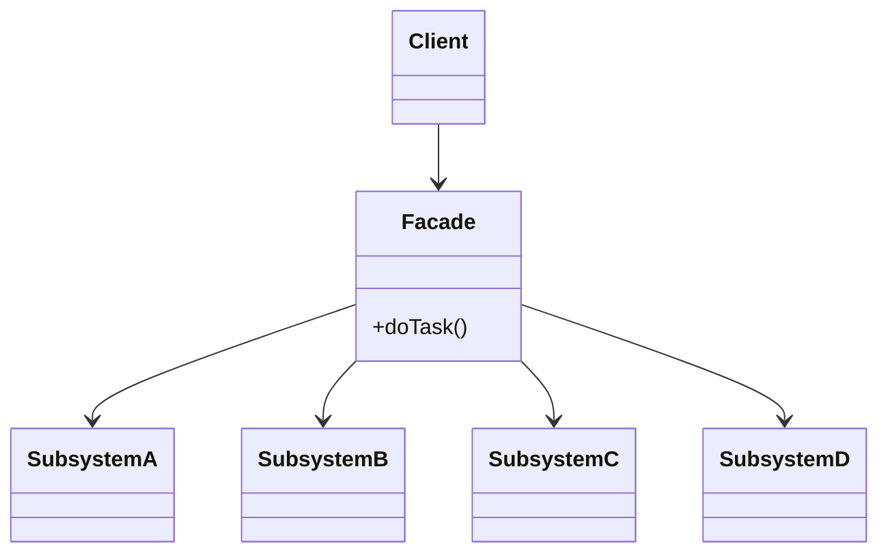
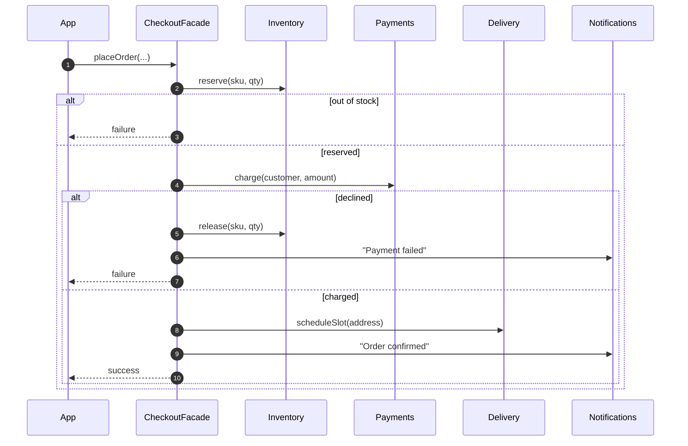
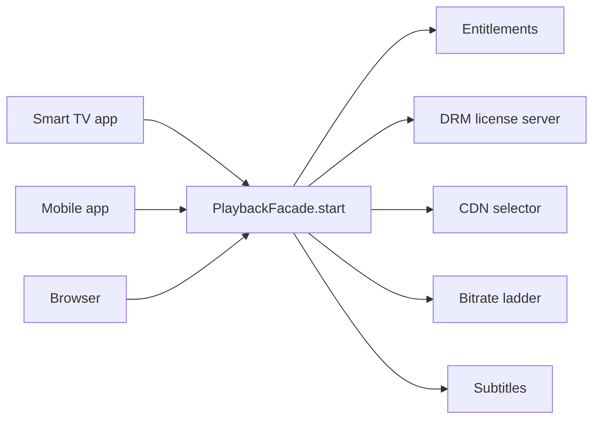
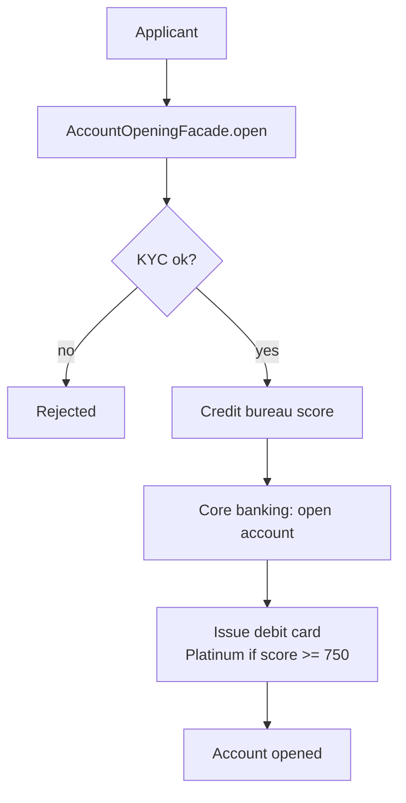

---
tags:
  - Structural
  - Beginner
---

# Facade

<span class="badge badge--beginner">🟢 Beginner</span>
<span class="badge badge--category">Structural</span>
<span class="badge badge--interview">Interview frequency ⭐⭐⭐⭐</span>

!!! abstract "TL;DR"
    **Facade gives a simple, high-level interface to a complex set of classes or services.**
    Use it when clients need to do one *thing* ("place order", "start playback", "open account") that takes many steps across many subsystems.

---

## 1. Intent & Problem It Solves

**The problem in plain English:** placing a grocery order means reserving stock, charging the card, booking a delivery slot and notifying the customer, and if the payment fails, releasing the stock. If the Android app, the iOS app and the web app each do these steps themselves, you get three slightly different checkouts, three places to fix bugs, and clients coupled to four services.

**Formal definition (GoF):**
> Provide a unified interface to a set of interfaces in a subsystem. Facade defines a higher-level interface that makes the subsystem easier to use.

## 2. Real-World Analogy

!!! example "A hotel concierge"
    You tell the concierge "I'd like dinner at 8 and a taxi to the airport tomorrow at 6." They call the restaurant, the taxi company and the front desk. You never deal with any of them directly, though you still *could* if you wanted to.

## 3. Structure



| Participant | Responsibility |
|---|---|
| **Facade** | Knows which subsystems to call, in what order, and how to handle failures; exposes **task-level** methods |
| **Subsystems** | Do the real work; don't know the facade exists |
| **Client** | Calls the facade (and can still use subsystems directly for advanced needs) |

## 4. Naive Approach (Without the Pattern)

```java
// In the Android app's checkout screen...
if (inventory.reserve(sku, qty)) {
    try {
        String pay = payments.charge(customer, amount);
        String slot = delivery.scheduleSlot(address);
        notifications.send(customer, "Order confirmed " + slot);
    } catch (Exception e) {
        // forgot to release inventory here; the iOS app remembered
    }
}
// ...copied into the iOS app, the web app, and the partner API
```

- :material-close-circle:{ style="color:#e53935" } **Duplicated workflows** that drift apart (one client forgets compensation).
- :material-close-circle:{ style="color:#e53935" } **Tight coupling**: every client depends on four services.
- :material-close-circle:{ style="color:#e53935" } Changing the workflow (add fraud check) means changing **every** client.

---

## 5. Three Real-World Examples

### Example 1: One-Tap Checkout (Grocery)

**Scenario:** A quick-commerce app wants "one-tap reorder". Behind the button: reserve stock in the dark store, charge the saved card, book a delivery slot, notify the customer. Out-of-stock and declined cards are common, and when the payment fails, the reserved stock **must** be released or it shows as unavailable to other customers. Mobile, web and the voice assistant all call the same facade.

**Design:**



**Full Code:**

=== "CheckoutFacade.java"

    ```java
    --8<-- "code/structural/src/main/java/com/handbook/structural/facade/checkout/CheckoutFacade.java"
    ```

    1.  Subsystems are **injected**, so the facade is easy to test with fakes and doesn't hide how it's wired.
    2.  A **task-level** method: the client says *what* it wants, not *how*.
    3.  **Compensation** lives in one place. Every client gets the correct failure handling for free.

=== "Subsystems.java"

    ```java
    --8<-- "code/structural/src/main/java/com/handbook/structural/facade/checkout/Subsystems.java"
    ```

=== "CheckoutDemo.java"

    ```java
    --8<-- "code/structural/src/main/java/com/handbook/structural/facade/checkout/CheckoutDemo.java"
    ```

**Output:**

```text
--8<-- "code/outputs/structural/facade/checkout/CheckoutDemo.txt"
```

Order C shows the facade's value: the payment failed, and the stock was released **without the app knowing it had been reserved**.

**Why Facade here:**

- A **multi-step workflow** that every client needs, with **one correct failure path**.
- Clients depend on **one** interface instead of four services.
- Adding a fraud check later is a change in the facade only.

---

### Example 2: Press Play (Streaming)

**Scenario:** Before a streaming player shows the first frame, it needs: an entitlement check (is this a premium title?), a **DRM license** (security level depends on the device), the best **CDN edge** for the viewer's city, a **starting bitrate** for their bandwidth and HDR support, and **subtitle tracks** for their locale. Smart TVs, phones and browsers each used to call all five services, and each platform team got it slightly wrong. A `PlaybackFacade` gives every player one call.

**Design:**



**Full Code:**

=== "PlaybackFacade.java"

    ```java
    --8<-- "code/structural/src/main/java/com/handbook/structural/facade/streaming/PlaybackFacade.java"
    ```

=== "PlaybackSubsystems.java"

    ```java
    --8<-- "code/structural/src/main/java/com/handbook/structural/facade/streaming/PlaybackSubsystems.java"
    ```

=== "PlaybackDemo.java"

    ```java
    --8<-- "code/structural/src/main/java/com/handbook/structural/facade/streaming/PlaybackDemo.java"
    ```

**Output:**

```text
--8<-- "code/outputs/structural/facade/streaming/PlaybackDemo.txt"
```

**Why Facade here:**

- **Five subsystems, one question**: "how do I start playing this title on this device?"
- Returns a single, immutable `PlaybackSession` record, which is easy to serialize as one API response (this is also how a **Backend for Frontend** works).
- Platform teams stop re-implementing (and mis-implementing) entitlement and DRM rules.

---

### Example 3: Open a Bank Account (Banking)

**Scenario:** Opening a savings account involves KYC verification (PAN and Aadhaar format checks, in reality calls to government APIs), a credit bureau score, account creation in the core banking system, and debit card issuance (Platinum for scores of 750+). The same flow is used by the mobile app, branch tablets and partner fintech APIs. Compliance wants the KYC rule enforced identically everywhere.

**Design:**



**Full Code:**

=== "AccountOpeningFacade.java"

    ```java
    --8<-- "code/structural/src/main/java/com/handbook/structural/facade/banking/AccountOpeningFacade.java"
    ```

=== "OnboardingSubsystems.java"

    ```java
    --8<-- "code/structural/src/main/java/com/handbook/structural/facade/banking/OnboardingSubsystems.java"
    ```

=== "OnboardingDemo.java"

    ```java
    --8<-- "code/structural/src/main/java/com/handbook/structural/facade/banking/OnboardingDemo.java"
    ```

**Output:**

```text
--8<-- "code/outputs/structural/facade/banking/OnboardingDemo.txt"
```

**Why Facade here:**

- **Regulatory consistency**: one implementation of the KYC gate for every channel.
- Channels (app, branch, partners) stay thin; the onboarding team can change vendors behind the facade.
- The facade is the natural place for **orchestration-level rules** (card tier by score).

---

??? example "Unit Tests: `FacadeTest.java` (all three examples + challenge)"

    ```java
    --8<-- "code/structural/src/test/java/com/handbook/structural/facade/FacadeTest.java"
    ```

## 6. Variations & Modern Java Take

- **Facade with injected subsystems** (Example 1) vs. **facade that owns its subsystems** (Examples 2, 3). Prefer injection for testability; owning is fine for small, internal helpers.
- **Multiple facades** over the same subsystems for different audiences (an admin facade and a customer facade).
- **Records as results**: return one immutable result (`PlaybackSession`) instead of making the client gather pieces.
- **Service layer = facade**: in Spring apps, an `@Service` that orchestrates repositories and clients for a use case is a facade. Annotate it `@Transactional` and the whole use case runs in one transaction.
- **Network-level facades**: an **API Gateway** or **Backend for Frontend** (BFF) is a facade over microservices (covered in the Microservices section).

## 7. Where It Lives in Real Frameworks

| Where | Facade over |
|---|---|
| **SLF4J** | Logging back-ends (its name literally means *Simple Logging Facade for Java*) |
| Spring `JdbcTemplate` | `Connection`, `PreparedStatement`, `ResultSet`, exception translation, resource cleanup |
| Spring `RestClient` / `RestTemplate` | HTTP client libraries, message converters, error handling |
| Spring `JavaMailSender` | JavaMail sessions, MIME messages, transports |
| `java.net.http.HttpClient` | Connections, HTTP/2, TLS, redirects |
| `javax.faces.context.FacesContext` | JSF request, response, application state |
| `java.util.concurrent.Executors` | Static facade over `ThreadPoolExecutor` configuration |
| Hibernate `Session` / JPA `EntityManager` | Persistence context, SQL generation, caching, flushing |

## 8. Pros, Cons & Trade-offs

| ✅ Pros | ❌ Cons |
|---|---|
| **Simple API** for common tasks | Can become a **god object** if every feature is added to it |
| **Decouples** clients from subsystem details (Law of Demeter) | May hide useful subsystem features (keep subsystems accessible) |
| **One place** for workflows, ordering and compensation | Another layer to maintain and version |
| Easier to **change subsystems** behind it | If it does too little, it's just pass-through boilerplate |

## 9. Pitfalls & Anti-Patterns

!!! danger "The god facade"
    `AppFacade` with 140 methods covering orders, users, payments and reports is a monolith in one class. Make facades **per use case or bounded context** (`CheckoutFacade`, `OnboardingFacade`).

!!! warning "Pass-through facades"
    A facade whose every method just calls one subsystem method adds nothing. A facade earns its place by **combining** steps or **simplifying** a complex API.

!!! warning "Hiding failures"
    A facade that swallows subsystem exceptions and returns "success" makes debugging impossible. Translate failures into clear results or domain exceptions (Example 1's `Result`).

!!! warning "Distributed transactions in disguise"
    A facade calling four **remote** services can't make them atomic. Design compensation explicitly (Example 1), or use the **Saga** pattern for long-running flows.

## 10. Senior / Architect Deep Dive (10–15 yrs)

**Facade vs. orchestrator vs. saga.** In-process, a facade orchestrates local calls and can use one database transaction. Across services, the same idea becomes an **orchestrator** (Saga orchestration) that must handle partial failure, retries, idempotency and timeouts. Be explicit in design reviews about which you're building.

**Application services in DDD / Clean Architecture.** The "use case" or "application service" layer is a set of facades: each method is one use case (`PlaceOrder`, `OpenAccount`), coordinating domain objects and ports. Controllers stay thin; domain objects stay free of orchestration.

**API design.** Facades define what clients can do. Design them around **tasks**, not entities (`placeOrder`, not `createOrder` + `addLine` + `submit`), return **complete results**, and version them carefully; mobile apps live in the wild for years.

**Performance.** A facade calling five independent services can call them **in parallel** (`CompletableFuture`, structured concurrency with virtual threads), turning the sum of latencies into the maximum. Example 2's DRM, CDN, bitrate and subtitle lookups are independent and could all run concurrently.

!!! bug "War story: three checkouts, three bugs"
    A retailer's Android, iOS and web apps each orchestrated checkout themselves. Only iOS released reserved stock on payment failure. During a sale, Android and web payment failures left thousands of items "reserved" but never sold; the site showed popular items out of stock while the warehouse was full. Lost sales were estimated in crores of rupees.
    **Fix:** a server-side `CheckoutFacade` (later a saga orchestrator) owning the workflow and compensation; all apps switched to a single `POST /checkout`; reservations got a TTL as a safety net.
    **Lesson:** workflows belong on the server, in one place, not copied into every client.

## 11. Related Patterns & Comparisons

| | Facade | Adapter | Mediator | Proxy | API Gateway |
|---|---|---|---|---|---|
| Wraps | **Many** subsystems | **One** class | **Colleagues** that talk to each other | **One** subject | Many services (network) |
| Interface | **New, simpler** | Converted to an expected one | Mediator interface | **Same** as subject | HTTP routes |
| Who talks to whom | Client → facade → subsystems (subsystems unaware) | Client → adapter → adaptee | Colleagues → mediator → colleagues (two-way) | Client → proxy → subject | Client → gateway → services |

## 12. Interview Corner

=== "🟢 Beginner / Service Companies"

    **Q1. What is the Facade pattern?**

    A structural pattern that provides a **simple, unified interface** to a **complex subsystem**, so clients don't deal with its many classes directly.

    **Q2. Give an example.**

    A `CheckoutFacade.placeOrder()` hiding inventory, payment, delivery and notification services; in Java, **SLF4J** and Spring's **`JdbcTemplate`**.

    **Q3. Does a facade prevent access to subsystems?**

    **No.** It simplifies common use; advanced clients can still use the subsystems directly.

    **Q4. Facade vs. Adapter?**

    Facade **simplifies many** classes behind a **new** interface. Adapter **converts one** class's interface to the one a client **expects**.

    **Q5. Which principle does Facade support?**

    **Law of Demeter** (talk to few friends), **loose coupling**, and **Single Responsibility** (the workflow lives in one place).

=== "🟡 Mid-Level"

    **Q1. Is a Spring `@Service` a facade?**

    Often, yes: a service method that orchestrates several repositories and clients for one use case is a facade, often with `@Transactional` around it.

    **Q2. How do you stop a facade becoming a god class?**

    One facade **per use case group or bounded context**; keep business rules in domain objects; split when it grows unrelated methods.

    **Q3. How do you test a facade?**

    Inject **fakes** for subsystems; test the **workflow and failure paths** (payment fails, so stock is released), not the subsystems themselves.

    **Q4. Facade vs. Mediator?**

    A facade is **one-way**: clients call it, subsystems don't know it. A mediator coordinates **two-way** communication between colleagues that know the mediator.

    **Q5. Can a facade call services in parallel?**

    Yes, if the calls are independent: `CompletableFuture.allOf(...)` or structured concurrency with virtual threads. Total latency becomes the slowest call rather than the sum.

=== "🔴 Senior / FAANG / SAP"

    **Q1. "Design the backend for a mobile app home screen that needs data from 8 services."**

    A **BFF** (backend-for-frontend) facade: one endpoint per screen, **parallel fan-out** with per-call timeouts, **partial responses** (show what you have; a missing "recommendations" section is fine), caching, and response shaping for mobile (small payloads). Discuss versioning for old app versions.

    **Q2. "Your checkout facade calls 4 services over the network. How do you keep data consistent?"**

    No distributed transaction: use a **saga** (orchestrated by the facade/orchestrator) with **compensations**, **idempotency keys**, an **outbox** for reliable events, reservation **TTLs** as a safety net, and **reconciliation** jobs.

    **Q3. "When is a facade an anti-pattern in microservices?"**

    When it becomes a **distributed monolith** chokepoint that every change must go through, or when it holds business logic that belongs in the domain services. Keep facades thin: orchestration and shaping, not core rules.

    **Q4. "How do facades relate to Hexagonal/Clean architecture?"**

    **Application services (use cases)** are facades over the domain and ports. Inbound adapters (REST controllers, message listeners) call them; they coordinate domain objects and outbound ports.

    **Q5. "Latency budget: p99 must be under 300 ms, and the facade calls 5 services. Approach?"**

    Run independent calls **in parallel**, give each a **timeout** within the budget, use **hedged requests** for tail latency, **cache** stable data (entitlements, CDN maps), and **degrade gracefully** (no subtitles is better than no playback).

=== "💻 Coding Challenge"

    **Problem (ride-hailing):** Booking a ride needs a fare (with 1.5× surge at peak), a payment **hold** for that fare, and a driver match. If no driver is found, the hold **must be released**. Give the app a single `book(...)` call.

    ??? success "Solution"

        === "RideBookingFacade.java"

            ```java
            --8<-- "code/structural/src/main/java/com/handbook/structural/facade/ride/RideBookingFacade.java"
            ```

        === "RideDemo.java"

            ```java
            --8<-- "code/structural/src/main/java/com/handbook/structural/facade/ride/RideDemo.java"
            ```

        **Output:**

        ```text
        --8<-- "code/outputs/structural/facade/ride/RideDemo.txt"
        ```

        **Key points to say:** one task-level method; the **compensation** (release the hold) lives in the facade so no client can forget it; subsystems stay independent and reusable. Discussion point: matching **before** holding avoids the compensation entirely, so ask which order the business prefers (holding first guarantees payment before a driver commits).

!!! info "Behavioural tie-in (STAR) for experienced candidates"
    - **S:** Three client apps implemented checkout separately; stock stayed reserved after failed payments during a sale.
    - **T:** Fix the bug everywhere and stop it from recurring.
    - **A:** Built a server-side checkout facade with compensation, migrated the apps to one endpoint behind a feature flag, and added reservation TTLs.
    - **R:** "Phantom out-of-stock" incidents went to zero; checkout changes now ship once instead of three times.

## 13. Quick Revision Card

!!! tip "Remember in 30 seconds"
    - **One simple, task-level interface** over **many** subsystems.
    - Holds the **workflow, ordering and compensation**; subsystems don't know it exists.
    - Doesn't block direct access to subsystems.
    - Avoid **god facades** (split per use case) and **pass-through** facades.
    - **Real life:** SLF4J, `JdbcTemplate`, Spring `@Service` use cases, API Gateway / BFF.

    ```java
    Result r = checkoutFacade.placeOrder(customer, address, sku, qty, amount);
    ```

## Practice

- [ ] Add a fraud check to `CheckoutFacade` without changing any client.
- [ ] Make `PlaybackFacade` call DRM, CDN, bitrate and subtitles in parallel with virtual threads.
- [ ] Return a typed result (sealed interface: `Booked`, `NoDriver`) from `RideBookingFacade` instead of a `String`.

---

[:material-arrow-left: Decorator](decorator.md){ .md-button }
[Next: Flyweight :material-arrow-right:](flyweight.md){ .md-button .md-button--primary }
