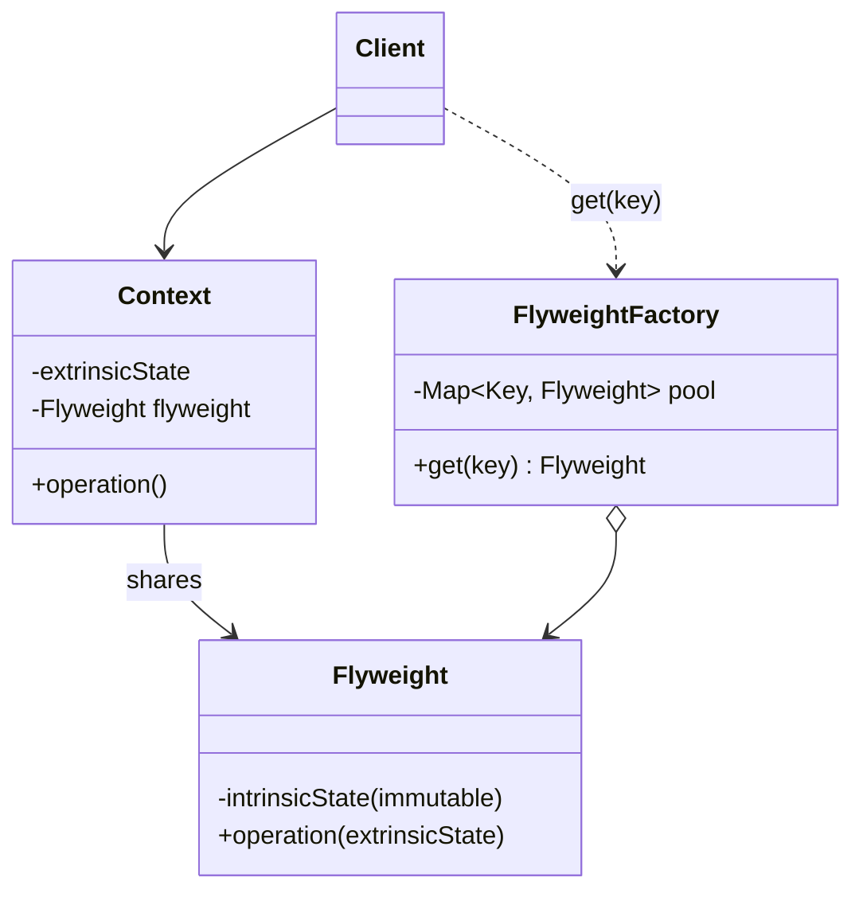
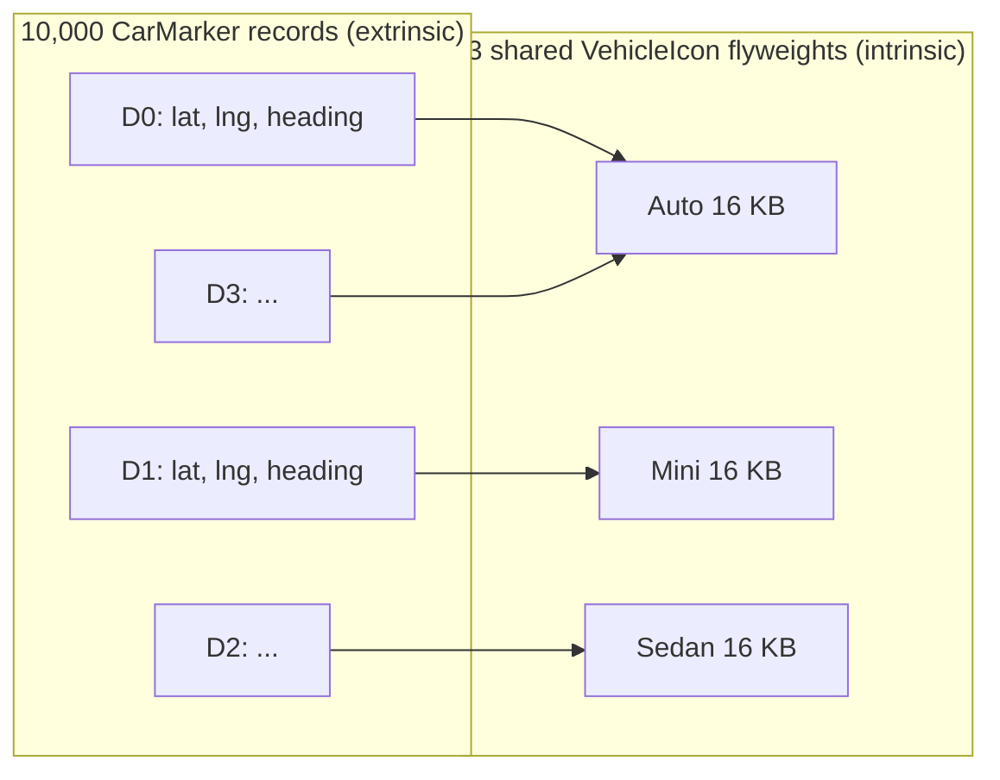
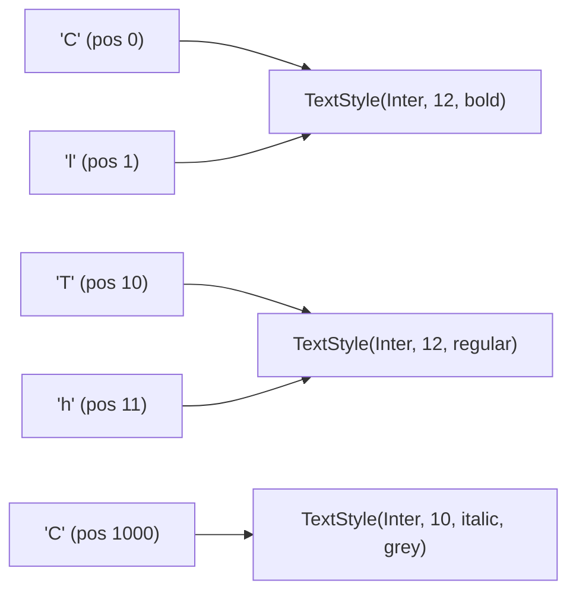
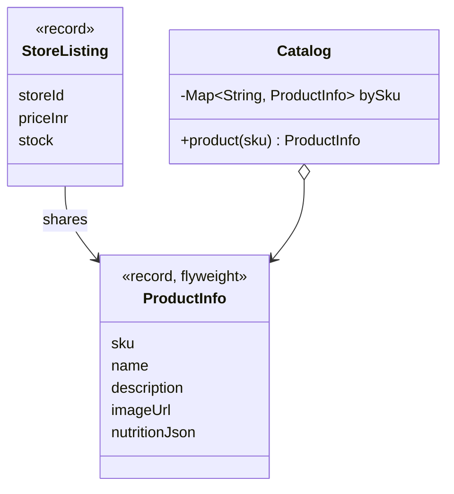

---
tags:
  - Structural
  - Advanced
---

# Flyweight

<span class="badge badge--advanced">🟡 Intermediate → 🔴 Advanced</span>
<span class="badge badge--category">Structural</span>
<span class="badge badge--interview">Interview frequency ⭐⭐⭐</span>

!!! abstract "TL;DR"
    **Flyweight saves memory by sharing the common, immutable part of many similar objects instead of copying it into each one.**
    Use it when you have a **huge number** of objects whose state splits cleanly into a shared part (**intrinsic**) and a per-object part (**extrinsic**).

---

## 1. Intent & Problem It Solves

**The problem in plain English:** a ride-hailing map shows 10,000 cars. If each car object carries its own 16 KB icon bitmap, that's **160 MB** for three distinct pictures (Auto, Mini, Sedan). Only position and heading differ per car. Share the three icons, keep a tiny marker per car, and memory drops to well under 1 MB.

**Formal definition (GoF):**
> Use sharing to support large numbers of fine-grained objects efficiently.

**The two kinds of state:**

| | Intrinsic | Extrinsic |
|---|---|---|
| Meaning | Same for many objects | Unique to each object/use |
| Where it lives | **Inside the flyweight** (shared) | **Outside**: in a context object, or passed as method arguments |
| Must be | **Immutable** | Anything |
| Map example | Icon bitmap, vehicle type | Latitude, longitude, heading |

## 2. Real-World Analogy

!!! example "Printing type"
    Old printing presses didn't carve a new letter "e" for every "e" on the page. They had a tray of reusable metal letters (**shared, intrinsic**) and arranged them in positions (**extrinsic**). One "e" design, used thousands of times.

## 3. Structure



| Participant | Responsibility |
|---|---|
| **Flyweight** | Immutable, shared intrinsic state; operations take extrinsic state as parameters |
| **Flyweight factory** | Creates each flyweight **once** per key and returns the shared instance |
| **Context** | Small per-object data (extrinsic) + a reference to its flyweight |
| **Client** | Gets flyweights from the factory, never with `new` |

## 4. Naive Approach (Without the Pattern)

```java
record CarMarker(String driverId, double lat, double lng, int heading, byte[] iconBitmap) {}

for (Driver d : drivers) {
    markers.add(new CarMarker(d.id(), d.lat(), d.lng(), d.heading(),
            loadIcon(d.type())));       // 16 KB copied 10,000 times, and loaded from disk 10,000 times
}
```

- :material-close-circle:{ style="color:#e53935" } **Memory explosion**: identical data duplicated thousands of times.
- :material-close-circle:{ style="color:#e53935" } **Slow**: identical data loaded or created over and over, and more GC pressure.

---

## 5. Three Real-World Examples

### Example 1: 10,000 Live Cars on the Map (Ride-hailing)

**Scenario:** A ride-hailing ops dashboard shows every active car in Bengaluru, updated every few seconds. There are three vehicle types, each with a 64×64 RGBA icon (16 KB). Cars move constantly (position and heading change), but their icons never do. The dashboard runs on modest laptops in the ops centre, so memory matters.

**Design:**



**Full Code:**

=== "VehicleIcon.java"

    ```java
    --8<-- "code/structural/src/main/java/com/handbook/structural/flyweight/ridemap/VehicleIcon.java"
    ```

    1.  Extrinsic state (position, heading) is **passed in**, never stored in the flyweight. That's what makes it safe to share.

=== "IconFactory.java"

    ```java
    --8<-- "code/structural/src/main/java/com/handbook/structural/flyweight/ridemap/IconFactory.java"
    ```

    1.  `computeIfAbsent` on a `ConcurrentHashMap` creates each icon **at most once**, even when many threads ask at the same time.

=== "CarMarker.java"

    ```java
    --8<-- "code/structural/src/main/java/com/handbook/structural/flyweight/ridemap/CarMarker.java"
    ```

=== "RideMapDemo.java"

    ```java
    --8<-- "code/structural/src/main/java/com/handbook/structural/flyweight/ridemap/RideMapDemo.java"
    ```

**Output:**

```text
--8<-- "code/outputs/structural/flyweight/ridemap/RideMapDemo.txt"
```

About **300× less memory** for the same picture on screen. (The marker size is an estimate; measure real numbers with JOL or a heap dump.)

**Why Flyweight here:**

- **Huge count** (10,000+) of objects with **heavy, identical** parts.
- Clean split: icon = intrinsic, position = extrinsic.
- The icon is naturally **immutable**.

---

### Example 2: Styled Text in a Collaborative Editor (SaaS)

**Scenario:** A Google-Docs-style editor stores formatting for every character. A 3-page contract has about 3,000 characters but only **3 distinct styles** (bold heading, body text, grey italic footer). Storing a separate style object per character wastes memory on the server (which holds thousands of open documents) and makes "are these two runs the same style?" an expensive deep comparison.

**Design:**



**Full Code:**

=== "TextStyle.java"

    ```java
    --8<-- "code/structural/src/main/java/com/handbook/structural/flyweight/editor/TextStyle.java"
    ```

    1.  **Interning with a record**: records get `equals`/`hashCode` from their components, so a freshly built style finds its equal twin in the pool, and the pool returns the **shared** one. The candidate object is garbage straight away. This is exactly how `String.intern()` works.

=== "Document.java"

    ```java
    --8<-- "code/structural/src/main/java/com/handbook/structural/flyweight/editor/Document.java"
    ```

=== "EditorDemo.java"

    ```java
    --8<-- "code/structural/src/main/java/com/handbook/structural/flyweight/editor/EditorDemo.java"
    ```

**Output:**

```text
--8<-- "code/outputs/structural/flyweight/editor/EditorDemo.txt"
```

**Why Flyweight here:**

- Thousands of characters, a **handful** of styles.
- Interned styles make "same style?" an **identity check** (`==`), which is fast for merging runs.
- Styles are **value objects**, immutable by nature.

---

### Example 3: Product Data Across Dark Stores (Grocery)

**Scenario:** A quick-commerce company runs 200 dark stores, each stocking the same 50 fast-moving products (in reality thousands). Name, long description, image URL and nutrition JSON are **identical in every store**; only **price and stock** differ by store. The pricing service holds every store's listings in memory for fast lookups. Without sharing, each listing carries its own copy of the catalog text.

**Design:**



**Full Code:**

=== "Catalog.java"

    ```java
    --8<-- "code/structural/src/main/java/com/handbook/structural/flyweight/grocery/Catalog.java"
    ```

=== "ProductInfo.java"

    ```java
    --8<-- "code/structural/src/main/java/com/handbook/structural/flyweight/grocery/ProductInfo.java"
    ```

=== "StoreListing.java"

    ```java
    --8<-- "code/structural/src/main/java/com/handbook/structural/flyweight/grocery/StoreListing.java"
    ```

=== "DarkStoreDemo.java"

    ```java
    --8<-- "code/structural/src/main/java/com/handbook/structural/flyweight/grocery/DarkStoreDemo.java"
    ```

**Output:**

```text
--8<-- "code/outputs/structural/flyweight/grocery/DarkStoreDemo.txt"
```

10,000 listings share **50** product objects, and the catalog was loaded only 50 times instead of 10,000.

**Why Flyweight here:**

- A **classic data-modelling split**: global catalog data vs. per-store data.
- Cuts memory **and** load calls to the catalog service.
- Records make both parts immutable and easy to reason about.

---

??? example "Unit Tests: `FlyweightTest.java` (all three examples + challenge)"

    ```java
    --8<-- "code/structural/src/test/java/com/handbook/structural/flyweight/FlyweightTest.java"
    ```

## 6. Variations & Modern Java Take

- **Interning with records** (Example 2): value equality makes a `Map<T, T>` pool trivial.
- **Bounded or weak pools**: a pool that grows forever is a memory leak. For unbounded key spaces, use a size-limited cache (Caffeine) or weak references (Guava `Interners.newWeakInterner()`).
- **Enum as flyweights**: enum constants are the simplest flyweights, a fixed set of shared instances.
- **Primitive arrays as a data-oriented alternative**: for millions of points, a structure-of-arrays layout (`double[] lats, lngs`) beats any object model. Know when to leave OOP behind.
- **Project Valhalla (future)**: value classes will let the JVM flatten small objects, reducing the per-object overhead that often motivates Flyweight.

## 7. Where It Lives in Real Frameworks

| Where | Flyweight |
|---|---|
| JDK | `Integer.valueOf(-128..127)`, `Long.valueOf`, `Character.valueOf`, `Boolean.valueOf` caches |
| JDK | `String.intern()` and the string constant pool; compact strings |
| JDK | Enum constants; `Collections.emptyList()`; `Optional.empty()` |
| JDK | `java.time.ZoneId.of(...)`, `ZoneOffset` caching |
| Text rendering | Glyph caches in Java2D, browsers, and editors |
| Games / maps | Shared meshes, textures and icons (the GoF example is glyphs in a document editor) |
| Guava | `Interners`, `ImmutableList.of()` singletons |

!!! question "Classic trap"
    `Integer a = 127, b = 127; a == b` is **true** (cached flyweights), but with `128` it's **false**. Always compare wrappers with `equals()`. This comes up in service-company interviews all the time.

## 8. Pros, Cons & Trade-offs

| ✅ Pros | ❌ Cons |
|---|---|
| **Large memory savings** with many similar objects | More **complex** model: state is split in two |
| Fewer allocations, **less GC** pressure | Extrinsic state must be **passed around**, which complicates APIs |
| Fast **identity comparison** of interned values | The **factory** needs thread-safety and a size or eviction policy |
| | No benefit with few objects or little shared state, only complexity |

## 9. Pitfalls & Anti-Patterns

!!! danger "Mutable flyweights"
    If anyone can change a shared icon or style, the change appears **everywhere**. Flyweights must be immutable: `final` fields, records, defensive copies of arrays.

!!! danger "Unbounded pools"
    Interning user-provided strings (hashtags, search terms) without a limit is a memory leak and a denial-of-service vector. Bound it, or use weak references.

!!! warning "Premature flyweighting"
    The JVM is very good at small objects. Measure with a heap histogram (`jcmd <pid> GC.class_histogram`) before adding a factory and splitting state.

!!! warning "Identity comparisons outside the pool"
    `==` only works if **every** instance came from the factory. One `new TextStyle(...)` bypassing `of()` breaks it. Keep constructors private when you rely on identity.

## 10. Senior / Architect Deep Dive (10–15 yrs)

**Measure first.** Use JOL (Java Object Layout) to see real object sizes (headers, padding, compressed oops) and a heap dump analyser (Eclipse MAT) to find **duplicate** data: MAT's "duplicate strings" and "retained size by class" reports point directly at Flyweight opportunities.

**Flyweight at the data layer.** The same idea appears as **normalization** in databases (store product data once, reference it by ID), **dictionary encoding** in columnar formats (Parquet, Arrow), and **string deduplication** in G1 (`-XX:+UseStringDeduplication`), which the JVM does for you.

**Caches are flyweight factories with eviction.** In services, the "factory" is often a cache keyed by ID (Example 3). Design for invalidation (product name changed) and for the memory budget (max size, weigher).

**Concurrency.** Immutable flyweights are inherently thread-safe; the only shared mutable structure is the factory's map. `ConcurrentHashMap.computeIfAbsent` gives "create at most once per key", but keep the creation function fast, because it runs while that map bin is locked.

!!! bug "War story: the interner that ate the heap"
    A social app interned every hashtag in posts and search queries with `String.intern()`-style pooling to "save memory". A spam campaign generated millions of random hashtags (`#a8f7d...`). The pool grew without bound, full GCs took seconds, and the search service fell over during a trending event.
    **Fix:** intern only tags from an allow-list of trending and known tags; everything else used plain strings; the pool became a bounded Caffeine cache with weak values; input validation rejected tags over 50 characters.
    **Lesson:** a flyweight pool is a cache. Bound it, and never key it by untrusted input without limits.

## 11. Related Patterns & Comparisons

| | Flyweight | Singleton | Object Pool | Prototype |
|---|---|---|---|---|
| Instances | **Few shared**, one per distinct intrinsic state | Exactly **one** | Several, **borrowed exclusively** | Many **copies** |
| Mutable? | **No** | Maybe | Yes, while borrowed | Yes |
| Used by | **Many at the same time** | Everyone | One borrower at a time | Each copy's owner |
| Goal | **Save memory** | One global instance | Avoid expensive creation, limit count | Avoid expensive setup |

**Often combined with:** Factory (to create and share flyweights), Composite (shared leaf nodes in big trees, like characters in a document), State/Strategy (stateless strategies and states are flyweights).

## 12. Interview Corner

=== "🟢 Beginner / Service Companies"

    **Q1. What is the Flyweight pattern?**

    A structural pattern that **reduces memory** by **sharing** common parts of many similar objects instead of storing them in every object.

    **Q2. What are intrinsic and extrinsic state?**

    **Intrinsic** is shared and immutable, stored **in** the flyweight (icon image). **Extrinsic** is unique per use, stored **outside** or passed in (position).

    **Q3. Give a Java example.**

    **`Integer.valueOf()`** caches -128 to 127; the **String pool**; enum constants.

    **Q4. Why is `Integer a = 127, b = 127; a == b` true but 128 false?**

    Autoboxing uses `Integer.valueOf`, which returns **cached flyweights** for -128 to 127; 128 creates new objects. Use `equals()` for wrappers.

    **Q5. Why must flyweights be immutable?**

    They're **shared**: a change through one reference would affect **every** user.

=== "🟡 Mid-Level"

    **Q1. How do you implement a thread-safe flyweight factory?**

    `ConcurrentHashMap.computeIfAbsent(key, Factory::create)`, so each key is created **once** even under concurrency; flyweights themselves are immutable.

    **Q2. When is Flyweight not worth it?**

    With **few objects**, little **shared** state, or when the shared part is small compared to the per-object overhead. Measure first.

    **Q3. Flyweight vs. Singleton?**

    Singleton is **one** instance of a class; flyweights are **one instance per distinct intrinsic state**, many classes of usage sharing a few objects.

    **Q4. Flyweight vs. Object Pool?**

    Pools lend **mutable** objects **exclusively** and take them back; flyweights are **immutable** and used by **everyone at once**.

    **Q5. How do records help?**

    Records give **value-based `equals`/`hashCode`** and immutability, so interning is just `pool.computeIfAbsent(candidate, k -> k)`.

=== "🔴 Senior / FAANG / SAP"

    **Q1. "Our service's heap is 70% duplicate strings. What do you do?"**

    Confirm with **MAT's duplicate-strings report**. Options: G1 **string deduplication**, interning a **bounded** set of known values (enums, codes, country names), **dictionary-encoding** data loaded from files or databases, and fixing the source (deserializers creating new strings for repeated values).

    **Q2. "Render 1 million points on a map in a browser or a Java client."**

    Flyweight for shared styles and icons; **structure-of-arrays** for coordinates (`float[]`); **level-of-detail clustering**; render on the GPU. Past a certain scale, data-oriented design beats object-per-point.

    **Q3. "How does a columnar database use the Flyweight idea?"**

    **Dictionary encoding**: a column with repeated values stores each distinct value once and small integer codes per row; the same intrinsic/extrinsic split, applied to storage.

    **Q4. "Design an interning service for user-generated tags under adversarial load."**

    Validate and normalize input; intern only **allow-listed or popular** tags; a **bounded cache** with weak values for the rest; monitor pool size; rate-limit tag creation per user.

    **Q5. "Where else do you see Flyweight in system design?"**

    **CDNs** (one cached asset served to millions), **container image layers** (shared base layers), **copy-on-write** memory pages after `fork()`, **database normalization**.

=== "💻 Coding Challenge"

    **Problem (social media):** Posts contain hashtags like `#Java`, `#java`, ` #JAVA `. Implement `Hashtag.of(raw)` that normalizes (trim, lowercase), validates, and returns **one shared instance** per tag, safe under concurrency.

    ??? success "Solution"

        === "Hashtag.java"

            ```java
            --8<-- "code/structural/src/main/java/com/handbook/structural/flyweight/social/Hashtag.java"
            ```

        === "HashtagDemo.java"

            ```java
            --8<-- "code/structural/src/main/java/com/handbook/structural/flyweight/social/HashtagDemo.java"
            ```

        **Output:**

        ```text
        --8<-- "code/outputs/structural/flyweight/social/HashtagDemo.txt"
        ```

        **Key points to say:** private constructor so every instance comes from `of()`; normalization **before** lookup so variants share one object; `Locale.ROOT` so lowercasing doesn't depend on the server's language (Turkish "I"); validation **bounds** the key space; and in production, a size-limited cache instead of an unbounded map (see the war story).

!!! info "Behavioural tie-in (STAR) for experienced candidates"
    - **S:** Our pricing service needed 28 GB of heap and had long GC pauses.
    - **T:** Cut memory without a rewrite.
    - **A:** Heap analysis showed catalog text duplicated per store listing; split listings into shared `ProductInfo` flyweights and per-store records, loaded through a bounded cache.
    - **R:** Heap dropped to 6 GB; p99 GC pause went from 1.8 s to 120 ms; we downsized the instances and saved about 40% on that service's compute bill.

## 13. Quick Revision Card

!!! tip "Remember in 30 seconds"
    - **Share** the common, **immutable** (intrinsic) part; keep the unique (extrinsic) part outside.
    - A **factory** creates each flyweight once per key (`computeIfAbsent`).
    - Worth it only with **many** objects and **heavy** shared state; measure first.
    - **Bound** the pool; never intern untrusted input without limits.
    - **JDK:** `Integer.valueOf` cache (127 vs 128 trap), the String pool, enums.

    ```java
    VehicleIcon icon = icons.computeIfAbsent(type, VehicleIcon::new);
    ```

## Practice

- [ ] Measure `CarMarker` and `VehicleIcon` sizes with JOL and update the estimate in the demo.
- [ ] Make the `TextStyle` pool bounded with Caffeine and weak values.
- [ ] Rewrite the map with structure-of-arrays (`double[]`) for 1 million cars and compare memory.

---

[:material-arrow-left: Facade](facade.md){ .md-button }
[Next: Proxy :material-arrow-right:](proxy.md){ .md-button .md-button--primary }
