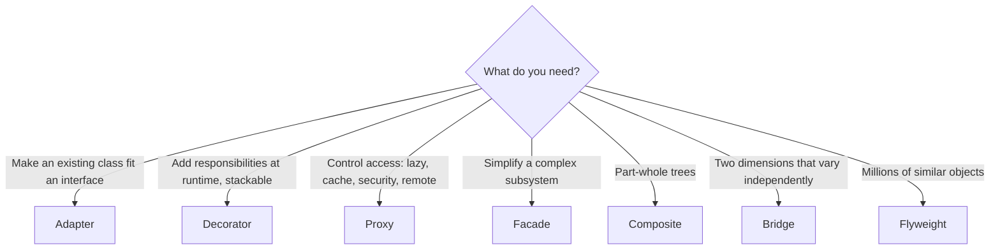

# Structural Patterns

Structural patterns answer: **how do classes and objects fit together into larger structures** while staying flexible?
They're about **composition**: wrapping, adapting, combining and sharing objects so that each piece stays simple.

| Pattern | Problem it solves | Interview frequency | Status |
|---|---|---|---|
| [Adapter](adapter.md) | Make an incompatible interface fit the one you need | ⭐⭐⭐⭐⭐ | ✅ |
| [Bridge](bridge.md) | Vary an abstraction and its implementation independently | ⭐⭐⭐ | ✅ |
| [Composite](composite.md) | Treat single objects and trees of objects the same way | ⭐⭐⭐⭐ | ✅ |
| [Decorator](decorator.md) | Add behavior to an object without subclassing | ⭐⭐⭐⭐⭐ | ✅ |
| [Facade](facade.md) | One simple entry point to a complex subsystem | ⭐⭐⭐⭐ | ✅ |
| [Flyweight](flyweight.md) | Share immutable state across many objects to save memory | ⭐⭐⭐ | ✅ |
| [Proxy](proxy.md) | Control access to an object (lazy, remote, cached, secured) | ⭐⭐⭐⭐⭐ | ✅ |

!!! tip "Adapter vs. Decorator vs. Proxy vs. Facade"
    All four wrap something. Ask **what changes**:
    **Adapter** changes the *interface*. **Decorator** keeps the interface and *adds behavior*. **Proxy** keeps the interface and *controls access*. **Facade** gives a *new, simpler* interface to *many* objects.
