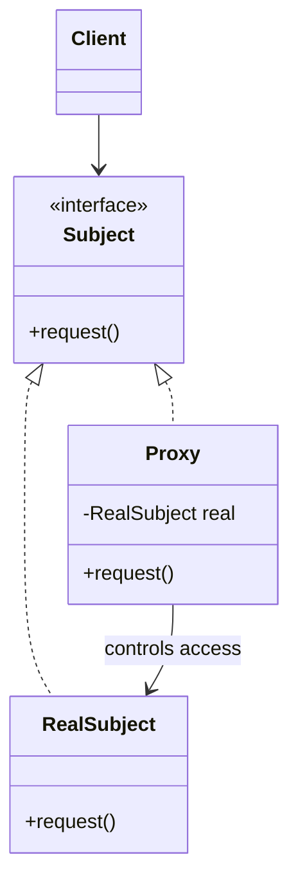
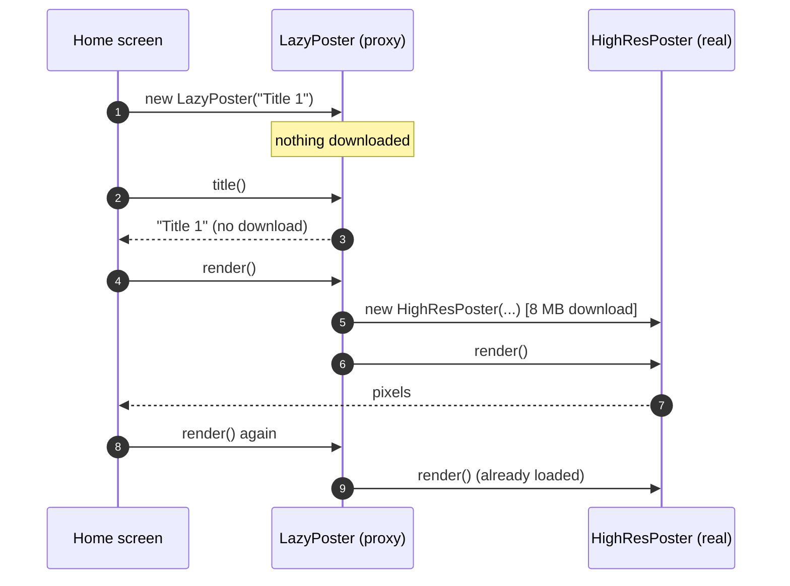
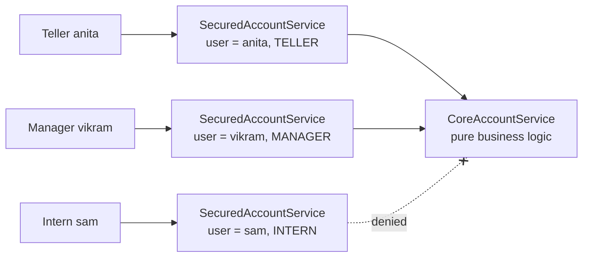
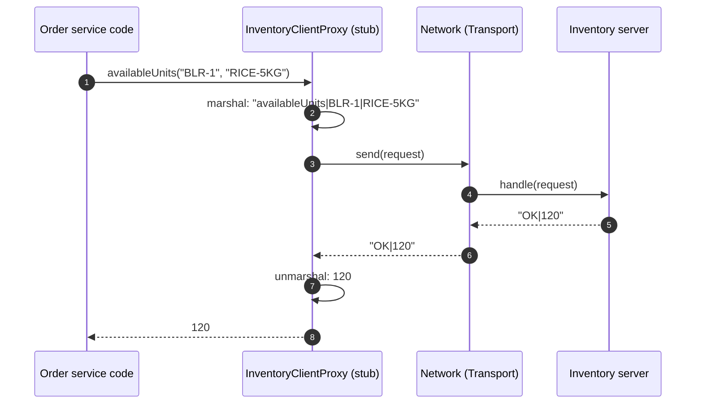

---
tags:
  - Structural
  - Intermediate
---

# Proxy

<span class="badge badge--intermediate">🟡 Intermediate</span>
<span class="badge badge--category">Structural</span>
<span class="badge badge--interview">Interview frequency ⭐⭐⭐⭐⭐</span>

!!! abstract "TL;DR"
    **A proxy is a stand-in with the same interface as the real object that controls access to it: creating it lazily, checking permissions, calling it over the network, caching, or logging.**
    Spring's `@Transactional`, Hibernate's lazy loading and every gRPC client stub are proxies, so understanding this pattern explains a lot of "framework magic".

---

## 1. Intent & Problem It Solves

**The problem in plain English:** sometimes you can't, or shouldn't, hand clients the real object directly. It may be expensive to create (an 8 MB image), sensitive (a bank account), or in another process (a remote service). You want clients to use it **as if it were the real thing**, while something in between decides **when, whether, and how** the real object is used.

**Formal definition (GoF):**
> Provide a surrogate or placeholder for another object to control access to it.

**The common kinds of proxy:**

| Kind | Controls | Example below |
|---|---|---|
| **Virtual proxy** | *When* the real object is created (lazily) | Example 1 |
| **Protection proxy** | *Whether* the caller may use it | Example 2 |
| **Remote proxy** | *Where* it lives (another process or machine) | Example 3 |
| **Caching proxy** | Reusing results | Decorator page's challenge, Spring `@Cacheable` |
| **Logging / monitoring proxy** | Recording calls | Coding challenge (dynamic proxy) |
| **Smart reference** | Reference counting, locking, lazy init of associations | Hibernate lazy collections |

## 2. Real-World Analogy

!!! example "A company's receptionist"
    You want to meet the CEO. The receptionist (proxy) looks like the way in: you talk to them as if they were the office. They check whether you have an appointment (**protection**), call the CEO only when it's your turn (**virtual**), or connect you by video if the CEO is in another city (**remote**). The CEO's job doesn't change at all.

## 3. Structure



| Participant | Responsibility |
|---|---|
| **Subject** | The interface clients use |
| **Real subject** | Does the actual work; contains **no** access-control code |
| **Proxy** | Same interface; decides when and whether to forward, and may add work around the call |
| **Client** | Can't tell (and shouldn't care) whether it holds the proxy or the real subject |

## 4. Naive Approach (Without the Pattern)

```java
public String withdraw(User user, String acc, long amount) {
    if (amount > 50_000 && !user.roles().contains("MANAGER")) throw new SecurityException();
    if (!user.roles().contains("TELLER") && !user.roles().contains("MANAGER")) throw new SecurityException();
    // ...actual business logic, mixed with security checks...
}
// Every method repeats checks. Someone adds a new method and forgets them.
```

- :material-close-circle:{ style="color:#e53935" } **Cross-cutting code mixed with business logic** (security, laziness, networking).
- :material-close-circle:{ style="color:#e53935" } **Easy to forget** in one method, which becomes a security hole.
- :material-close-circle:{ style="color:#e53935" } Business classes become hard to test in isolation.

---

## 5. Three Real-World Examples

### Example 1: Lazy Posters on the Home Screen (Streaming) — *Virtual Proxy*

**Scenario:** A streaming app's home screen has rows of 40 titles each. High-resolution posters are 8 MB each to download and decode. Users usually see the first few tiles and scroll a little. Creating all posters up front means 320 MB of downloads per row, a slow start-up and wasted mobile data. Search and analytics only need the **title**, never the image.

**Design:**



**Full Code:**

=== "LazyPoster.java"

    ```java
    --8<-- "code/structural/src/main/java/com/handbook/structural/proxy/streaming/LazyPoster.java"
    ```

    1.  The real subject starts as `null`: nothing expensive has happened yet.
    2.  Cheap requests are answered **by the proxy itself**, without creating the real object.
    3.  The real object is created on **first use** and then reused. For multi-threaded access, use the holder idiom or a lock (see [Singleton](../creational/singleton.md)).

=== "HighResPoster.java"

    ```java
    --8<-- "code/structural/src/main/java/com/handbook/structural/proxy/streaming/HighResPoster.java"
    ```

=== "Poster.java"

    ```java
    --8<-- "code/structural/src/main/java/com/handbook/structural/proxy/streaming/Poster.java"
    ```

=== "HomeScreenDemo.java"

    ```java
    --8<-- "code/structural/src/main/java/com/handbook/structural/proxy/streaming/HomeScreenDemo.java"
    ```

**Output:**

```text
--8<-- "code/outputs/structural/proxy/streaming/HomeScreenDemo.txt"
```

40 posters on the screen, **3 downloads**. Scrolling back doesn't download again.

**Why a virtual proxy here:**

- The real object is **expensive** and often **never needed**.
- Clients (the UI) keep using the `Poster` interface unchanged.
- This is exactly how **Hibernate lazy loading** works: your entity's `getOrders()` returns a proxy collection that queries the database on first access.

---

### Example 2: Role-Based Access at the Branch Counter (Banking) — *Protection Proxy*

**Scenario:** Bank branch software lets tellers check balances and make withdrawals up to INR 50,000; bigger withdrawals need a **manager**. Interns can't access accounts at all. The core account service is shared with ATMs and internet banking, which have their own rules, so it must contain **no** branch-specific security code. Auditors want access rules in **one** reviewable place.

**Design:**



**Full Code:**

=== "SecuredAccountService.java"

    ```java
    --8<-- "code/structural/src/main/java/com/handbook/structural/proxy/banking/SecuredAccountService.java"
    ```

    1.  Rules can depend on **arguments**, not just on the method: large withdrawals need a stronger role.
    2.  Denials throw **before** the real subject is touched, so a denied call has no side effects.

=== "CoreAccountService.java"

    ```java
    --8<-- "code/structural/src/main/java/com/handbook/structural/proxy/banking/CoreAccountService.java"
    ```

=== "AccountService.java"

    ```java
    --8<-- "code/structural/src/main/java/com/handbook/structural/proxy/banking/AccountService.java"
    ```

=== "BranchDemo.java"

    ```java
    --8<-- "code/structural/src/main/java/com/handbook/structural/proxy/banking/BranchDemo.java"
    ```

**Output:**

```text
--8<-- "code/outputs/structural/proxy/banking/BranchDemo.txt"
```

**Why a protection proxy here:**

- Security is **separated** from business logic: `CoreAccountService` is reused by ATM and online channels with different proxies.
- Access rules live in **one** auditable class.
- In Spring, `@PreAuthorize("hasRole('MANAGER')")` generates this kind of proxy for you.

---

### Example 3: Calling the Inventory Service (Logistics) — *Remote Proxy*

**Scenario:** An order service checks stock in the inventory service, which runs in another cluster. Order-service developers want to write `inventory.availableUnits("BLR-1", "RICE-5KG")` as if it were a local call. Behind it, the call must be **marshalled** into a request, sent over the network, and the response **unmarshalled**. Network failures must surface as a clear domain error (`InventoryUnavailableException`), not a raw `IOException` deep in business code.

**Design:**



**Full Code:**

=== "InventoryClientProxy.java"

    ```java
    --8<-- "code/structural/src/main/java/com/handbook/structural/proxy/remote/InventoryClientProxy.java"
    ```

    1.  **Marshalling**: the method call becomes a message. Real stubs use JSON over HTTP, or Protobuf over gRPC.
    2.  **Unmarshalling** the response back into a Java value.
    3.  Transport errors become a **domain exception**. The caller learns "inventory is unavailable", not "socket closed".

=== "InventoryServer.java"

    ```java
    --8<-- "code/structural/src/main/java/com/handbook/structural/proxy/remote/InventoryServer.java"
    ```

=== "InventoryApi + Transport"

    ```java
    --8<-- "code/structural/src/main/java/com/handbook/structural/proxy/remote/InventoryApi.java"
    ```

    ```java
    --8<-- "code/structural/src/main/java/com/handbook/structural/proxy/remote/Transport.java"
    ```

=== "RemoteDemo.java"

    ```java
    --8<-- "code/structural/src/main/java/com/handbook/structural/proxy/remote/RemoteDemo.java"
    ```

**Output:**

```text
--8<-- "code/outputs/structural/proxy/remote/RemoteDemo.txt"
```

**Why a remote proxy here:**

- **Location transparency**: business code uses an interface, not HTTP.
- Marshalling and error translation live in one generated or hand-written class.
- This is what **gRPC stubs**, **Spring Cloud OpenFeign** and Spring 6 **HTTP interface clients** (`@HttpExchange`) generate for you.

!!! warning "Remote calls are not local calls"
    A remote proxy makes a network call *look* local, but it can fail, time out and be slow (the "fallacies of distributed computing"). Always add timeouts, retries for idempotent calls, and circuit breakers. Never call a remote proxy in a tight loop without thinking.

---

??? example "Unit Tests: `ProxyTest.java` (all three examples + challenge)"

    ```java
    --8<-- "code/structural/src/test/java/com/handbook/structural/proxy/ProxyTest.java"
    ```

## 6. Variations & Modern Java Take

**Three ways to build proxies in Java:**

| Mechanism | How | Limits |
|---|---|---|
| **Hand-written** (Examples 1–3) | Implement the interface, forward calls | One class per interface |
| **JDK dynamic proxy** (`java.lang.reflect.Proxy`) | One `InvocationHandler` for any interface, generated at runtime (coding challenge) | **Interfaces only** |
| **Bytecode subclassing** (CGLIB, ByteBuddy) | Generates a subclass at runtime | Can't proxy `final` classes or methods; needs a non-private constructor |

**Spring AOP** uses JDK proxies when your bean implements an interface and CGLIB subclasses otherwise (Spring Boot defaults to CGLIB: `proxyTargetClass = true`).

!!! danger "The self-invocation trap (Spring)"
    `@Transactional`, `@Cacheable`, `@Async` work because callers hold a **proxy**. If a method calls another `@Transactional` method **on `this`**, the call bypasses the proxy, and the annotation is **silently ignored**. Fix: move the method to another bean, or inject the bean's own proxy. Almost every Spring interview at 5+ years asks about this.

## 7. Where It Lives in Real Frameworks

| Where | Kind of proxy |
|---|---|
| **Spring AOP**: `@Transactional`, `@Cacheable`, `@Async`, `@Retryable`, `@PreAuthorize` | Protection / caching / smart proxies around beans |
| Spring `@Configuration` classes | CGLIB proxy so `@Bean` methods return singletons |
| Spring Data repositories | The interface you declare is implemented by a **generated proxy** |
| **Hibernate / JPA** | Lazy entity proxies (`getReference`), lazy collections (`PersistentBag`) |
| **gRPC**, **OpenFeign**, Spring `@HttpExchange`, Java RMI | Remote proxies (client stubs) |
| JDK | `java.lang.reflect.Proxy`; `Collections.unmodifiableList` (protection) |
| Mockito | Mocks and spies are runtime-generated proxies |
| HikariCP | `ProxyConnection`: `close()` returns the connection to the pool |

## 8. Pros, Cons & Trade-offs

| ✅ Pros | ❌ Cons |
|---|---|
| **Controls access** without changing the real subject | Extra indirection; possible latency (remote) or complexity |
| Separates cross-cutting concerns (security, laziness, remoting) | Behavior can be **surprising** (self-invocation, lazy-init exceptions) |
| Clients unchanged: same interface | Dynamic proxies only work with interfaces; CGLIB can't handle `final` |
| Enables lazy loading, caching, auditing transparently | Debugging generated proxies is harder (stack traces, `$Proxy12`) |

## 9. Pitfalls & Anti-Patterns

!!! danger "Spring self-invocation"
    Calling a proxied method from inside the same bean bypasses the proxy. Transactions, caching and security silently don't apply.

!!! danger "LazyInitializationException"
    A Hibernate lazy proxy accessed **after** the session or transaction closed throws. Fetch what you need inside the transaction (fetch joins, entity graphs, DTO projections), and don't rely on Open Session in View.

!!! warning "Hiding expensive remote calls"
    `for (Order o : orders) inventory.availableUnits(...)` looks innocent but makes N network calls. Offer **batch** methods on remote interfaces.

!!! warning "Identity and `equals`"
    `proxy == real` is false, `getClass()` returns the proxy class, and Hibernate proxies may not be initialized when `equals` is called. Use IDs and `instanceof` carefully.

## 10. Senior / Architect Deep Dive (10–15 yrs)

**Proxies at every level of the stack:**

| Level | Proxy |
|---|---|
| Object | Spring AOP, Hibernate lazy loading |
| Process | Sidecars (Envoy in Istio/Linkerd) intercept all traffic for mTLS, retries, metrics |
| Network | Reverse proxies (Nginx), API gateways, forward proxies, CDNs (caching proxies) |
| Database | PgBouncer, ProxySQL, RDS Proxy (connection pooling and routing) |

The same trade-offs apply at each level: transparency vs. surprise, added latency, and a new failure point.

**Designing remote interfaces for proxies.** Coarse-grained operations (`reserveItems(List<Item>)`) instead of chatty ones; idempotency keys on writes; explicit timeouts and deadlines propagated across calls; versioned schemas (Protobuf field numbers).

**Lazy loading strategy in JPA.** Default `@ManyToOne` is **eager** (a common performance trap); set `fetch = LAZY` and fetch explicitly per use case with entity graphs or join fetches. Watch for N+1 queries caused by proxies initializing one by one. Enable Hibernate statistics in tests to catch them.

!!! bug "War story: the @Transactional that wasn't"
    A wallet service had `transfer()` call `this.debit()` and `this.credit()`, each annotated `@Transactional(propagation = REQUIRES_NEW)` to "isolate" them. `transfer()` itself wasn't transactional. Because of **self-invocation**, neither inner annotation applied: there was no transaction at all. When `credit()` failed on a constraint, `debit()` had already committed. Money vanished from wallets for 3 days before reconciliation caught it.
    **Fix:** `@Transactional` on `transfer()` (one transaction for both legs), inner methods moved to a separate `LedgerService` bean, and an integration test asserting rollback when credit fails.
    **Lesson:** annotations are proxies. If the call doesn't go through the proxy, the annotation doesn't exist.

## 11. Related Patterns & Comparisons

| | Proxy | Decorator | Adapter | Facade |
|---|---|---|---|---|
| Interface | **Same** as subject | **Same** as component | **Different** (converted) | **New, simpler** |
| Intent | **Control access** | **Add behavior** | Make it fit | Simplify a subsystem |
| Who creates it | Usually the **framework/factory**, hidden from the client | Usually the **client** composes stacks | Integration code | Application code |
| May skip the real call? | **Yes** (deny, cache hit, not loaded yet) | Rarely | No | N/A |
| Lifecycle of real object | Often **manages** it (lazy creation) | Receives it ready-made | Receives it | Uses many |

## 12. Interview Corner

=== "🟢 Beginner / Service Companies"

    **Q1. What is the Proxy pattern?**

    A structural pattern where a **surrogate object** with the **same interface** controls access to a real object, for lazy creation, security, remote access, caching or logging.

    **Q2. Types of proxies?**

    **Virtual** (lazy), **protection** (security), **remote** (another process), **caching**, **logging/smart reference**.

    **Q3. Proxy vs. Decorator?**

    Same structure. **Proxy controls access** (may not call the real object at all, often creates it); **Decorator adds behavior** and is composed by the client.

    **Q4. Give real examples.**

    Spring **`@Transactional`** proxies, **Hibernate lazy loading**, **gRPC/Feign** client stubs, and Java's `java.lang.reflect.Proxy`.

    **Q5. What is a dynamic proxy in Java?**

    A proxy class **generated at runtime** by `Proxy.newProxyInstance` for one or more **interfaces**, with all calls routed to an `InvocationHandler`.

=== "🟡 Mid-Level"

    **Q1. How does Spring implement `@Transactional`?**

    It wraps the bean in a **proxy** (JDK or CGLIB). The proxy starts a transaction, calls the real method, and commits or rolls back (on runtime exceptions by default).

    **Q2. Why does `@Transactional` not work on a method called from the same class?**

    **Self-invocation** calls `this.method()` on the real object, **bypassing the proxy**. Move the method to another bean or call through the proxy.

    **Q3. JDK dynamic proxy vs. CGLIB?**

    JDK proxies need **interfaces**; CGLIB creates a **subclass**, so it works without interfaces but not for `final` classes or methods.

    **Q4. What causes `LazyInitializationException`?**

    Accessing a Hibernate **lazy proxy** after the session is closed. Fetch needed data in the transaction (join fetch, entity graphs, DTOs).

    **Q5. What should a remote proxy handle besides marshalling?**

    **Timeouts**, **retries** (idempotent calls only), **error translation** to domain exceptions, **auth headers**, and **tracing** context propagation.

=== "🔴 Senior / FAANG / SAP"

    **Q1. "Design client libraries for 30 internal microservices."**

    Generate **remote proxies** from contracts (OpenAPI/Protobuf); a shared runtime layer for **timeouts, retries, circuit breakers, auth, tracing, metrics**; **batch** endpoints to avoid chattiness; versioning; and testing with contract tests and generated fakes.

    **Q2. "A service mesh sidecar vs. in-process proxies (libraries): trade-offs?"**

    **Sidecar** (Envoy): language-agnostic, uniform mTLS, retries and telemetry, changed without redeploying apps; but extra hop latency, resource cost, and operational complexity. **Library**: lower latency and richer semantics, but must be implemented per language and upgraded per service.

    **Q3. "Lazy loading caused an N+1 storm in production. How do you find and fix it, and prevent it?"**

    Find via **SQL logs/APM** (one query per row) or Hibernate statistics. Fix with **join fetch / entity graphs / batch fetching** (`@BatchSize`) or DTO projections. Prevent with tests that **assert query counts** and with lazy-by-default mappings plus explicit fetch plans.

    **Q4. "Design authorization for a multi-tenant SaaS API."**

    A **policy enforcement point** at the edge (gateway: authentication, coarse scopes) and **in-process protection proxies or AOP** (`@PreAuthorize`) for fine-grained checks, with a central **policy decision point** (OPA, Zanzibar-style). Always enforce tenant isolation in the data layer too (row-level security), not only in proxies.

    **Q5. "When would you avoid proxies?"**

    When the surprise cost is high: hot paths where the indirection matters, code that depends on object identity, `final`-heavy designs (records, sealed classes can't be CGLIB-proxied), and when explicit code (a decorator or a direct call) would be clearer.

=== "💻 Coding Challenge"

    **Problem:** Write **one** generic proxy that logs every method call, its arguments and its result (or exception) for **any** interface, without writing a class per interface. Make sure callers still see the **original** exception type.

    ??? success "Solution: JDK dynamic proxy"

        === "LoggingProxy.java"

            ```java
            --8<-- "code/structural/src/main/java/com/handbook/structural/proxy/dynamic/LoggingProxy.java"
            ```

            1.  `Method.invoke` wraps exceptions in `InvocationTargetException`. Rethrowing `getCause()` gives callers the **original** exception (`SecurityException`), so the proxy stays transparent. Forgetting this is the classic dynamic-proxy bug.

        === "DynamicProxyDemo.java"

            ```java
            --8<-- "code/structural/src/main/java/com/handbook/structural/proxy/dynamic/DynamicProxyDemo.java"
            ```

        **Output:**

        ```text
        --8<-- "code/outputs/structural/proxy/dynamic/DynamicProxyDemo.txt"
        ```

        **Key points to say:** `Proxy.newProxyInstance(classLoader, interfaces, handler)`; one handler serves every interface; exceptions are unwrapped; works only with **interfaces** (for classes you'd use ByteBuddy or CGLIB). This is how Spring AOP, Mockito and Feign work underneath.

!!! info "Behavioural tie-in (STAR) for experienced candidates"
    - **S:** Wallet transfers occasionally lost money; logs showed debits without matching credits.
    - **T:** Find the root cause and guarantee atomic transfers.
    - **A:** Found self-invocation bypassing `@Transactional` proxies; restructured into one transactional use case and a separate ledger bean; added rollback integration tests and an ArchUnit rule against `@Transactional` on private and self-called methods.
    - **R:** Zero ledger mismatches since; the rule caught two similar bugs in other services within a month.

## 13. Quick Revision Card

!!! tip "Remember in 30 seconds"
    - **Same interface, controls access**: virtual (lazy), protection (security), remote (stub), caching, logging.
    - The real subject stays **free** of cross-cutting code.
    - **Java:** hand-written, `java.lang.reflect.Proxy` (interfaces), CGLIB/ByteBuddy (subclasses).
    - **Spring:** `@Transactional`, `@Cacheable`, `@PreAuthorize` are proxies; **self-invocation bypasses them**.
    - **vs Decorator:** control access vs. add behavior.

    ```java
    T proxy = (T) Proxy.newProxyInstance(loader, new Class<?>[]{iface}, (p, m, a) -> m.invoke(target, a));
    ```

## Practice

- [ ] Make `LazyPoster` thread-safe without locking on every `render()` call.
- [ ] Add a batch method `availableUnits(String warehouse, List<String> skus)` and update the remote proxy.
- [ ] Reproduce the Spring self-invocation bug in a small Spring Boot app and fix it two ways.
- [ ] Extend `LoggingProxy` to time each call and report slow calls (over 100 ms).

---

[:material-arrow-left: Flyweight](flyweight.md){ .md-button }
[Next: Behavioral Patterns :material-arrow-right:](../behavioral/index.md){ .md-button .md-button--primary }
