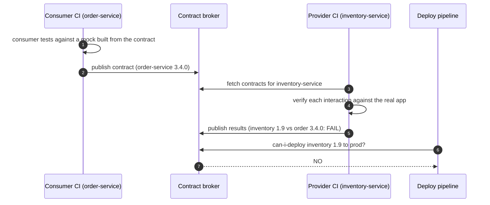
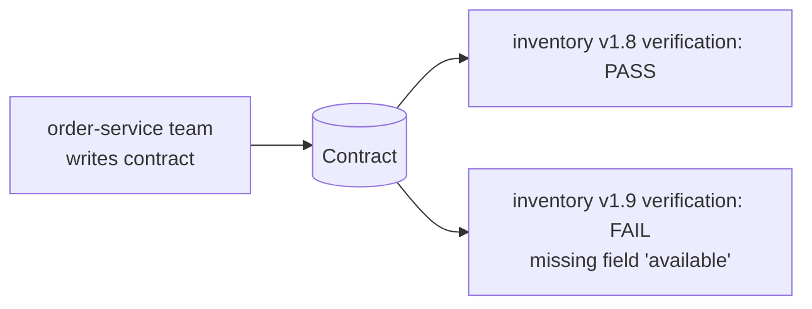
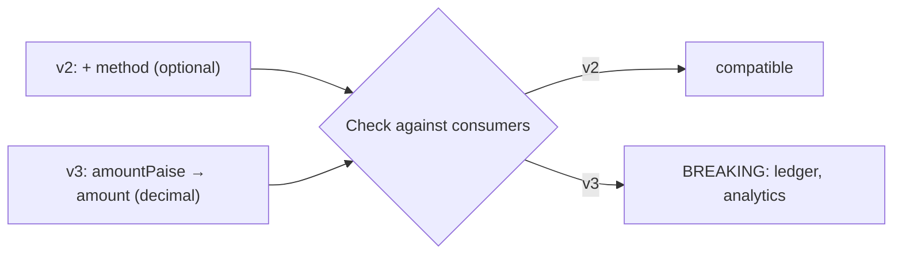
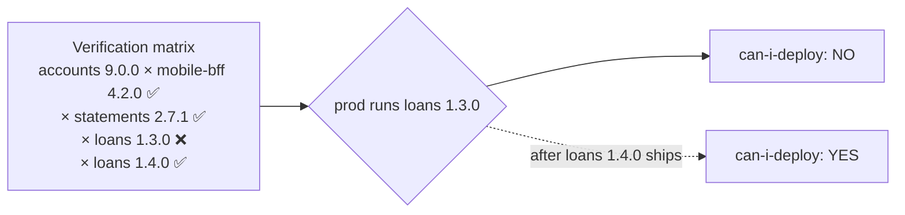

---
tags:
  - Testing
  - Intermediate
---

# Contract Testing

<span class="badge badge--intermediate">🟡 Intermediate → 🔴 Advanced</span>
<span class="badge badge--category">Testing</span>
<span class="badge badge--interview">Interview frequency ⭐⭐⭐⭐</span>

!!! abstract "TL;DR"
    **A contract test checks that a provider's API (or event) still satisfies what each consumer actually relies on. Consumers write the expectations; the provider verifies them in its own CI; a broker answers "can I deploy this version?".**
    Use it between services owned by different teams, instead of slow, flaky end-to-end test environments. Match on **shape and type**, not exact values.

---

## See It in Motion

<iframe class="motion-embed" src="../../motion/index.html?p=contract-testing&amp;embed=1" title="Animated walkthrough of the Contract Testing pattern" loading="lazy"></iframe>

Press **Play** to watch the calls travel between objects, or step through with **Next** and **Back**. Switch to **Without it** to see what goes wrong without the pattern. [Open the full explorer with all 75 patterns](../motion/index.html#contract-testing){ target=_blank }

## 1. Intent & Problem It Solves

**The problem in plain English:** the inventory team renames `available` to `availableQty` in a "harmless cleanup". Their unit tests pass. The order service's unit tests pass too (they use a stub with the old field). Both deploy, and order placement breaks in production. The usual fix, a shared end-to-end environment, is slow, flaky and always on the wrong versions.

**Definition (Martin Fowler / Ian Robinson, *Consumer-Driven Contracts*):**
> Each consumer captures its expectations of a provider in a contract. The provider runs all consumers' contracts as part of its build, so it knows immediately when a change would break a consumer.

**What a contract covers:**

| Kind | Consumer expectation | Provider verification |
|---|---|---|
| **HTTP** | "GET /stock/MILK-1L returns 200 with `sku` (string), `available` (integer)" | Replay the request against the real provider app, check the response |
| **Messages** | "`payment.captured` has `paymentId`, `amountPaise` (long)" | Check the producer's schema/sample against every consumer's needs |
| **Provider states** | "Given SKU MILK-1L has stock" | Set up that data before replaying |

## 2. Real-World Analogy

!!! example "A plug and a socket"
    An appliance maker (consumer) states, "my plug has three round pins, 5 A". The building's electrician (provider) checks every socket against the plugs actually in use before renovating. Nobody needs to plug in every appliance in the building to know the renovation is safe.

## 3. Structure



| Participant | Responsibility |
|---|---|
| **Consumer** | Writes interactions (request + expected response shape + provider state); tests itself against a generated stub |
| **Contract** | Versioned artefact (Pact JSON, Spring Cloud Contract DSL, AsyncAPI/Avro schema) |
| **Provider** | Verifies all consumers' contracts in its build, with provider-state setup |
| **Broker** | Stores contracts and verification results; answers can-i-deploy per environment |

## 4. Naive Approach (Without the Pattern)

```text
Shared "integration" environment with 40 services
→ deploy your branch, run 600 end-to-end tests (45 minutes)
→ 7 fail because another team's service is broken today
→ re-run; 3 different failures; merge anyway
```

- :material-close-circle:{ style="color:#e53935" } Slow and flaky; failures are often someone else's.
- :material-close-circle:{ style="color:#e53935" } Tests the versions that happen to be deployed, not the ones going to prod.
- :material-close-circle:{ style="color:#e53935" } Stubs in consumer unit tests silently drift from the real provider.

---

## 5. Three Real-World Examples

### Example 1: Order Service ↔ Inventory Service (Grocery)

**Scenario:** The order service calls `GET /stock/{sku}` before reserving stock. Its team writes a contract with two interactions: a known SKU (needs `sku`, `available` as an integer, `updatedAt` as an ISO timestamp) and an unknown SKU (404). The inventory team verifies the contract in CI. When v1.9 renames `available`, verification fails in **their** pipeline.

**Design:**



**Full Code:**

=== "Contract.java"

    ```java
    --8<-- "code/testing/src/main/java/com/handbook/testing/contract/core/Contract.java"
    ```

    1.  **Provider states** let each interaction set up the data it needs ("SKU MILK-1L has stock"), so contracts don't depend on whatever happens to be in a shared database.
    2.  Each field is checked with a **matcher**: present, right type or pattern. Fields the consumer doesn't mention can change freely.

=== "InventoryContractDemo.java"

    ```java
    --8<-- "code/testing/src/main/java/com/handbook/testing/contract/grocery/InventoryContractDemo.java"
    ```

**Output:**

```text
--8<-- "code/outputs/testing/contract/grocery/InventoryContractDemo.txt"
```

**Why contract testing here:**

- The breaking change is caught **before merge**, in the team that made it.
- Only fields the consumer uses are protected; providers can add or change the rest.
- Runs in seconds against the provider app, no shared environment.

---

### Example 2: Evolving a Payment Event (Payments)

**Scenario:** `payments.payment.captured.v1` is consumed by the ledger, notifications and analytics. The payments team wants to add the payment `method`, and later someone proposes renaming `amountPaise` to `amount` (decimal). Each consumer declares the fields it reads; the producer's new schema is checked against all of them before release.

**Design:**



**Full Code:**

=== "SchemaCompatibility.java"

    ```java
    --8<-- "code/testing/src/main/java/com/handbook/testing/contract/messages/SchemaCompatibility.java"
    ```

    1.  A field a consumer reads has disappeared: breaking.
    2.  A field changed type: breaking (even if the name is the same).

=== "PaymentEventDemo.java"

    ```java
    --8<-- "code/testing/src/main/java/com/handbook/testing/contract/messages/PaymentEventDemo.java"
    ```

**Output:**

```text
--8<-- "code/outputs/testing/contract/messages/PaymentEventDemo.txt"
```

**Why message contracts here:**

- Events have no request/response cycle, so breakages surface late (in a consumer's logs, hours later).
- Schema registries (Avro/Protobuf with BACKWARD compatibility) enforce the generic rules; consumer contracts add "what each consumer actually reads".
- Breaking changes become a planned new version, not an incident.

---

### Example 3: "Can I Deploy?" for the Accounts API (Banking)

**Scenario:** The accounts API is consumed by the mobile BFF, statements and loans. Version 9.0.0 removes `branchCode`. Loans 1.3.0 (in prod) still reads it; loans 1.4.0 (fixed) isn't in prod yet. The broker records which consumer versions each provider version was verified against, and the deploy pipeline asks whether 9.0.0 is safe for **the versions actually in prod**.

**Design:**



**Full Code:**

=== "ContractBroker.java"

    ```java
    --8<-- "code/testing/src/main/java/com/handbook/testing/contract/broker/ContractBroker.java"
    ```

    1.  The check uses the consumer versions **deployed in the target environment**, not the latest ones.
    2.  The answer names the blockers, so the provider team knows who to coordinate with.

=== "CanIDeployDemo.java"

    ```java
    --8<-- "code/testing/src/main/java/com/handbook/testing/contract/broker/CanIDeployDemo.java"
    ```

**Output:**

```text
--8<-- "code/outputs/testing/contract/broker/CanIDeployDemo.txt"
```

**Why a broker here:**

- Independent deploys need a precise answer for **this** environment's versions.
- Coordination becomes explicit: ship the consumer fix first, then the provider.
- Pact Broker / PactFlow provide exactly this matrix and the `can-i-deploy` CLI.

---

??? example "Unit Tests: `ContractTestingTest.java`"

    ```java
    --8<-- "code/testing/src/test/java/com/handbook/testing/ContractTestingTest.java"
    ```

## 6. Variations & Modern Java Take

=== "Pact JVM, consumer side (reference)"

    ```java
    @ExtendWith(PactConsumerTestExt.class)
    @PactTestFor(providerName = "inventory-service")
    class InventoryClientPactTest {
        @Pact(consumer = "order-service")
        V4Pact stock(PactDslWithProvider builder) {
            return builder.given("SKU MILK-1L has stock")
                .uponReceiving("stock for a known SKU").path("/stock/MILK-1L").method("GET")
                .willRespondWith().status(200)
                .body(new PactDslJsonBody().stringType("sku").integerType("available").datetime("updatedAt"))
                .toPact(V4Pact.class);
        }

        @Test void readsStock(MockServer server) {
            assertThat(new InventoryClient(server.getUrl()).available("MILK-1L")).isGreaterThanOrEqualTo(0);
        }
    }
    ```

=== "Pact JVM, provider side (reference)"

    ```java
    @Provider("inventory-service")
    @PactBroker
    @SpringBootTest(webEnvironment = RANDOM_PORT)
    class InventoryProviderPactTest {
        @TestTemplate @ExtendWith(PactVerificationSpringProvider.class)
        void verify(PactVerificationContext ctx) { ctx.verifyInteraction(); }

        @State("SKU MILK-1L has stock")
        void milkInStock() { stockRepository.save(new Stock("MILK-1L", 37)); }
    }
    ```

| Variation | Notes |
|---|---|
| **Consumer-driven (Pact)** | Consumers own contracts; providers verify; broker + can-i-deploy |
| **Provider-driven (Spring Cloud Contract)** | Provider writes contracts (Groovy/YAML DSL), generates tests and stub JARs for consumers |
| **Schema-based** | OpenAPI diff (oasdiff), Avro/Protobuf compatibility in a schema registry, AsyncAPI for events |
| **Bi-directional (PactFlow)** | Compare consumer pacts with the provider's OpenAPI spec |
| **Testcontainers + Pact Broker** | Run a broker locally or in CI (`pactfoundation/pact-broker` image) |

## 7. Where It Lives in Real Frameworks

| Where | Contract testing |
|---|---|
| Pact | Pact JVM (JUnit 5), Pact Broker / PactFlow, `pact-broker can-i-deploy` |
| Spring | Spring Cloud Contract (contracts → provider tests + WireMock stubs for consumers) |
| Schema registries | Confluent / Apicurio compatibility modes (BACKWARD, FORWARD, FULL) |
| OpenAPI | oasdiff / openapi-diff breaking-change checks in CI |
| gRPC | `buf breaking` for Protobuf changes |

## 8. Pros, Cons & Trade-offs

| ✅ Pros | ❌ Cons |
|---|---|
| Catches integration breaks in seconds, before merge | Teams must adopt it on both sides |
| Replaces most slow, flaky E2E tests | Contracts cover the interface, not end-to-end business flows |
| Providers know exactly which fields consumers use | Provider-state setup takes effort |
| Enables safe independent deploys (can-i-deploy) | Another piece of infrastructure (broker) to run |

## 9. Pitfalls & Anti-Patterns

!!! danger "Exact-value contracts"
    Asserting `pricePaise == 28500` fails whenever the provider's test data changes, which teaches teams to ignore failures (coding challenge). Contract the **shape**; test values in unit tests.

!!! danger "Using contracts as functional tests"
    "Order total is correct after a 10% coupon" is business behaviour; test it in the provider's own tests. Contracts check that the conversation is understood.

!!! warning "Consumers over-specifying"
    Listing every field "just in case" freezes the provider's API. Include only what the consumer reads.

!!! warning "Skipping can-i-deploy"
    Verifying contracts but deploying without checking the matrix for the target environment still lets incompatible versions meet in production.

## 10. Senior / Architect Deep Dive (10–15 yrs)

**Where it fits.** Unit tests with doubles inside a service; integration tests with Testcontainers for adapters; **contract tests between services**; a handful of E2E smoke tests for critical journeys. Contracts are what keep the consumer's stubs honest.

**Versioning and branches.** Tag contracts and verifications with git SHA and branch; use "pending pacts" so a new consumer expectation doesn't break the provider's main build before the feature is implemented; use "WIP pacts" to verify feature branches.

**Events at scale.** Combine a schema registry (generic compatibility rules) with consumer contracts (actual field usage). Treat a breaking change as a new event version published in parallel during migration, then retire the old one when no consumer contracts reference it.

!!! bug "War story: the field nobody knew was used"
    A banking platform removed `branchCode` from the accounts API because "no one uses it any more". The loans service used it to route documents. Shared-environment E2E tests didn't cover that path. Loan document generation failed for three days before anyone noticed.
    **Fix:** consumer-driven contracts for all 14 consumers of the accounts API, verification in the provider's CI, and `can-i-deploy` as a required pipeline step.
    **Lesson:** only consumers know what they depend on. Let them write it down.

## 11. Related Patterns & Comparisons

| | Contract Test | Integration Test | End-to-End Test | Schema Check |
|---|---|---|---|---|
| Scope | One consumer ↔ one provider interface | A service with its real infrastructure | Whole system | Message/API format |
| Speed | Seconds | Seconds–minutes | Minutes–hours | Seconds |
| Finds | Interface mismatches | Adapter bugs | Workflow bugs | Generic incompatibilities |
| Owner | Consumer writes, provider verifies | Service team | Shared / QA | Platform |

See [Test Doubles](test-doubles.md) (contracts keep stubs honest), [Anti-Corruption Layer](../microservices/anti-corruption-layer.md) and [Deployment Strategies](../microservices/deployment-strategies.md).

## 12. Interview Corner

=== "🟢 Beginner / Service Companies"

    **Q1. What is contract testing?**

    Testing that a provider's API matches what its consumers expect, without running both systems end to end.

    **Q2. What is consumer-driven contract testing?**

    Consumers define the expectations; the provider verifies them in its build.

    **Q3. Name tools for it.**

    Pact, Spring Cloud Contract, schema registries for events.

    **Q4. How is it different from an integration test?**

    Integration tests run a service with real infrastructure; contract tests check the agreement between two services' interfaces.

    **Q5. What is a provider state?**

    Data the provider sets up before verifying an interaction (e.g. "account 123 exists").

=== "🟡 Mid-Level"

    **Q1. Why match by type instead of exact values?**

    So contracts don't break when test data changes; they should protect the shape the consumer depends on.

    **Q2. Pact vs Spring Cloud Contract?**

    Pact is consumer-driven and polyglot, with a broker; Spring Cloud Contract is provider-driven, JVM-centric, generating tests and WireMock stubs.

    **Q3. What does can-i-deploy do?**

    Checks the broker's verification matrix to see if a version is compatible with the versions deployed in the target environment.

    **Q4. How do you contract-test Kafka events?**

    Message pacts or schema contracts: consumers declare fields they read; the producer verifies samples/schemas against them.

    **Q5. Is adding a field breaking?**

    Usually not for consumers (tolerant readers), as long as it's optional for them; removing or retyping a field is breaking.

=== "🔴 Senior / FAANG / SAP"

    **Q1. "Replace a 2-hour E2E suite for 30 services."**

    Contract tests on every service boundary, Testcontainers integration tests per service, can-i-deploy gating, and 10–20 E2E smoke tests for critical journeys.

    **Q2. "How do you handle a breaking change you must make?"**

    Expand/contract: add the new field/version, migrate consumers (their contracts change), verify, then remove the old once no contract references it.

    **Q3. "How do contracts work with feature branches?"**

    Tag by branch, use pending/WIP pacts so new expectations don't break the provider's main build prematurely.

    **Q4. "Public API with unknown consumers?"**

    Contracts can't cover unknown consumers; use OpenAPI diff checks, versioned endpoints, deprecation headers and long sunset periods.

    **Q5. "What do contracts not catch?"**

    Semantic changes with the same shape (units, meaning), performance, and multi-service workflow bugs.

=== "💻 Coding Challenge"

    **Problem:** A contract asserts exact values (`pricePaise == 28500`). The provider changes its seeded test price; the API is unchanged. Show the failure and fix the contract with type matchers.

    ??? success "Solution"

        === "ExactVsTypeDemo.java"

            ```java
            --8<-- "code/testing/src/main/java/com/handbook/testing/contract/matching/ExactVsTypeDemo.java"
            ```

        **Output:**

        ```text
        --8<-- "code/outputs/testing/contract/matching/ExactVsTypeDemo.txt"
        ```

        **Key points to say:** exact values make contracts fail for reasons unrelated to compatibility; use type/regex matchers for data and exact matching only for values that are part of the protocol (enums, the requested id).

!!! info "Behavioural tie-in (STAR) for experienced candidates"
    - **S:** Removing an "unused" API field broke loan document generation for three days; E2E tests didn't cover it.
    - **T:** Let 14 consumer teams and the provider deploy independently without breakages.
    - **A:** Introduced Pact consumer contracts, provider verification in CI with provider states, a Pact Broker, and can-i-deploy as a required pipeline gate; trimmed the shared E2E suite to smoke tests.
    - **R:** Zero integration incidents from API changes in the next two quarters; the pipeline got 70 minutes faster.

## 13. Quick Revision Card

!!! tip "Remember in 30 seconds"
    - **Consumers write expectations; providers verify them in CI.**
    - Match **shape and type**, not exact values.
    - Provider states set up data per interaction.
    - Broker + **can-i-deploy** for the target environment's versions.
    - Events: schema registry + consumer field contracts; breaking change = new version.

    ```java
    new PactDslJsonBody().stringType("sku").integerType("available")   // shape, not values
    ```

## Practice

- [ ] Add a `Regex` matcher for `sku` (`[A-Z]+-\w+`) and a provider that violates it.
- [ ] Extend `SchemaCompatibility` to warn when a required field becomes optional for producers.
- [ ] Add a `dev` environment to `CanIDeployDemo` with different consumer versions.

---

[:material-arrow-left: Test Doubles](test-doubles.md){ .md-button }
[Next: Test Data Builder & Object Mother :material-arrow-right:](test-data-builder.md){ .md-button .md-button--primary }
