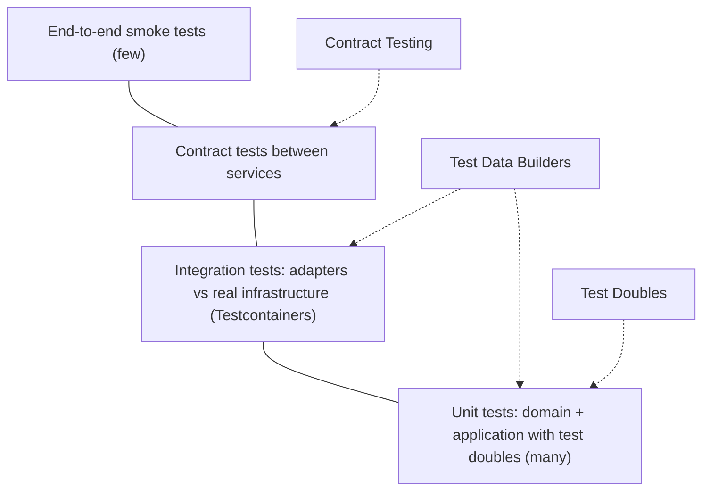

# Testing Patterns

Every pattern in this handbook ships with unit tests. This section is about the patterns **inside** those tests: how to replace dependencies, how to keep services compatible without a shared end-to-end environment, and how to create test data that makes each test's intent obvious.

| Pattern | Problem it solves | Interview frequency | Status |
|---|---|---|---|
| [Test Doubles](test-doubles.md) | Replace real dependencies with dummies, stubs, spies, mocks and fakes | ⭐⭐⭐⭐⭐ | ✅ |
| [Contract Testing](contract-testing.md) | Catch breaking API and event changes between services before deploy | ⭐⭐⭐⭐ | ✅ |
| [Test Data Builder & Object Mother](test-data-builder.md) | Readable, robust test setup with defaults, personas and generated data | ⭐⭐⭐ | ✅ |

## Where each pattern sits in the test pyramid

## Suggested learning order

1. [Test Doubles](test-doubles.md): the vocabulary every testing conversation uses.
2. [Test Data Builder & Object Mother](test-data-builder.md): make those tests readable.
3. [Contract Testing](contract-testing.md): scale testing across teams and services.

!!! tip "The one-sentence interview answer"
    "I unit-test domain and application code with **fakes and stubs** built from **test data builders**, reserve **mocks** for outgoing side effects, test adapters against real infrastructure with Testcontainers, protect service boundaries with **consumer-driven contracts** and can-i-deploy, and keep only a handful of end-to-end smoke tests."

## See every pattern here in motion

Pick any pattern below to watch it play, step through it, light up its code, and switch to **Without it** to see what goes wrong without it.

<iframe class="motion-embed motion-family" src="../motion/index.html?family=testing&amp;embed=1" title="Animated player for every testing pattern" loading="lazy"></iframe>

---

[:material-arrow-left: Domain Events](../enterprise/domain-events.md){ .md-button }
[Start: Test Doubles :material-arrow-right:](test-doubles.md){ .md-button .md-button--primary }
