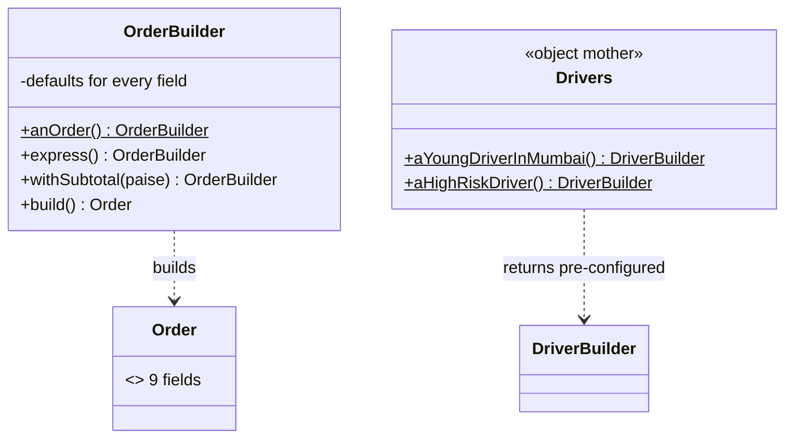
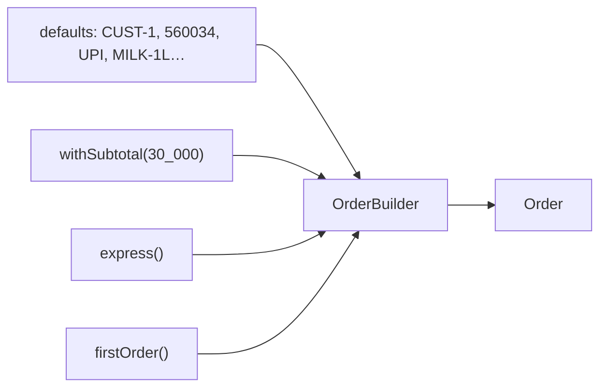
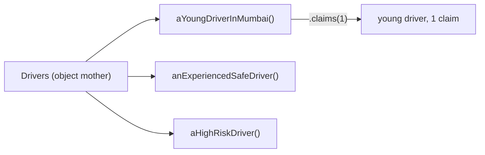
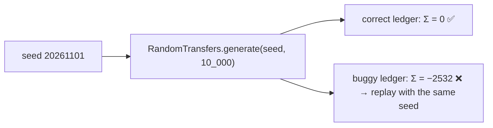

---
tags:
  - Testing
  - Beginner
---

# Test Data Builder & Object Mother

<span class="badge badge--beginner">🟢 Beginner → 🟡 Intermediate</span>
<span class="badge badge--category">Testing</span>
<span class="badge badge--interview">Interview frequency ⭐⭐⭐</span>

!!! abstract "TL;DR"
    **A Test Data Builder creates test objects with sensible defaults, so each test sets only the fields that matter to it (`anOrder().express().build()`). An Object Mother adds named, realistic personas on top (`aYoungDriverInMumbai()`).**
    Use them whenever test setup is longer than the test, or when adding a constructor parameter breaks dozens of tests.

---

## See It in Motion

<iframe class="motion-embed" src="../../motion/index.html?p=test-data-builder&amp;embed=1" title="Animated walkthrough of the Test Data Builder &amp; Object Mother pattern" loading="lazy"></iframe>

Press **Play** to watch the calls travel between objects, or step through with **Next** and **Back**. Switch to **Without it** to see what goes wrong without the pattern. [Open the full explorer](../motion/index.html#test-data-builder){ target=_blank }

## 1. Intent & Problem It Solves

**The problem in plain English:** `Order` has nine fields. A delivery-fee test only cares about the subtotal and "express", but has to write `new Order("O1", "C1", "560034", "18:00", "UPI", true, false, List.of(...), null)`. A reader can't tell which values matter. When a tenth field is added, 140 tests stop compiling.

**Definitions:**
> **Test Data Builder** (Nat Pryce; *Growing Object-Oriented Software, Guided by Tests*): a builder with safe default values for every field, and methods to override just the ones a test cares about.
>
> **Object Mother** (Peter Schuh & Stephanie Punke, ThoughtWorks): a factory of example objects, each representing a meaningful, named scenario.

| | Test Data Builder | Object Mother |
|---|---|---|
| Gives you | Defaults + fluent overrides | Named, ready-made personas |
| Flexibility | High: any combination | Low on its own (fixed shapes) |
| Readability | "What's different in this test" | "Which business scenario this is" |
| Best together | The mother returns **builders**, so tests can tweak a persona | |

## 2. Real-World Analogy

!!! example "Ordering a thali"
    The restaurant's standard thali (defaults) comes with dal, rice, two sabzis and a roti. You only say what's different: "extra roti, no sweet" (overrides). The menu also lists named thalis, "Gujarati", "Punjabi" (the Object Mother's personas), which you can still customise.

## 3. Structure



| Participant | Responsibility |
|---|---|
| **Builder** | Valid defaults for every field; intention-revealing `withX`/`asY` methods; `build()` |
| **Static entry point** | `anOrder()`, `aCustomer()`: reads like English in tests |
| **Object Mother** | Named personas that return builders |
| **Test** | Overrides only what matters, asserts on behaviour |

## 4. Naive Approach (Without the Pattern)

```java
@Test void expressSmallOrderFee() {
    Order o = new Order("O1", "C1", "560034", "Today 18:00-19:00", "UPI", true, false,
                        List.of(new Line("BASKET", 1, 30_000)), null);      // which of these matter?
    assertThat(o.deliveryFeePaise()).isEqualTo(5_500);
}
```

- :material-close-circle:{ style="color:#e53935" } Noise hides the one or two values the test is about.
- :material-close-circle:{ style="color:#e53935" } Every constructor change breaks every test.
- :material-close-circle:{ style="color:#e53935" } Copy-pasted setups drift and carry irrelevant, sometimes invalid, values.

---

## 5. Three Real-World Examples

### Example 1: Delivery-Fee Tests with a Builder (Grocery)

**Scenario:** Delivery fee rules: INR 25 below INR 499, free above it, +INR 30 for express, and always free for a customer's first order. Each test should state its case in one line. The builder supplies a valid customer, pincode, slot, payment method and basket by default.

**Design:**



**Full Code:**

=== "OrderBuilder.java"

    ```java
    --8<-- "code/testing/src/main/java/com/handbook/testing/testdata/grocery/OrderBuilder.java"
    ```

    1.  **Valid defaults** for every field: an order built with no overrides is a realistic, valid order.
    2.  A static entry point so tests read as sentences: `anOrder().express().build()`.
    3.  **Domain-level** overrides (`withSubtotal`) rather than raw setters for every field.

=== "Order.java"

    ```java
    --8<-- "code/testing/src/main/java/com/handbook/testing/testdata/grocery/Order.java"
    ```

=== "BuilderDemo.java"

    ```java
    --8<-- "code/testing/src/main/java/com/handbook/testing/testdata/grocery/BuilderDemo.java"
    ```

**Output:**

```text
--8<-- "code/outputs/testing/testdata/grocery/BuilderDemo.txt"
```

**Why a builder here:**

- Each test shows **only its difference** from a normal order.
- Adding a field to `Order` means changing **one** builder, not 140 tests.
- Defaults are valid, so tests don't accidentally exercise validation paths.

---

### Example 2: Driver Personas with an Object Mother (Insurance)

**Scenario:** Underwriters talk about "young drivers in metro cities", "experienced safe drivers" and "high-risk drivers". Premium tests use those exact personas, so business people can read them. Because each persona returns a **builder**, a test can still tweak one detail ("young driver in Mumbai, with one claim").

**Design:**



**Full Code:**

=== "Drivers.java"

    ```java
    --8<-- "code/testing/src/main/java/com/handbook/testing/testdata/insurance/Drivers.java"
    ```

    1.  Personas return a **builder**, not a finished object, which avoids the classic Object Mother problem of dozens of near-duplicate factory methods.

=== "PremiumCalculator.java"

    ```java
    --8<-- "code/testing/src/main/java/com/handbook/testing/testdata/insurance/PremiumCalculator.java"
    ```

=== "PersonasDemo.java"

    ```java
    --8<-- "code/testing/src/main/java/com/handbook/testing/testdata/insurance/PersonasDemo.java"
    ```

**Output:**

```text
--8<-- "code/outputs/testing/testdata/insurance/PersonasDemo.txt"
```

**Why an object mother here:**

- Tests speak the **business vocabulary**, which makes them reviewable by domain experts.
- Persona definitions live in one place; when underwriting redefines "young", one method changes.
- Builders keep the mother small and flexible.

---

### Example 3: Generated, Reproducible Data (Banking)

**Scenario:** A ledger must satisfy one invariant: money is never created or destroyed, so all balances sum to zero. Hand-written examples miss edge cases, so the test generates 10,000 random valid transfers **from a seed**. A buggy version that rounds large credits down is caught, and the seed is printed so the exact failing data can be replayed.

**Design:**



**Full Code:**

=== "RandomTransfers.java"

    ```java
    --8<-- "code/testing/src/main/java/com/handbook/testing/testdata/ledger/RandomTransfers.java"
    ```

    1.  **Seeded** randomness: the same seed always produces the same data, so a failure is reproducible.
    2.  Generated data must still be **valid** (no self-transfers), or failures are noise.

=== "LedgerPropertyDemo.java"

    ```java
    --8<-- "code/testing/src/main/java/com/handbook/testing/testdata/ledger/LedgerPropertyDemo.java"
    ```

**Output:**

```text
--8<-- "code/outputs/testing/testdata/ledger/LedgerPropertyDemo.txt"
```

**Why generated data here:**

- Invariants ("sum is zero", "balance never negative") are best tested across **many** inputs.
- Edge cases (large amounts, repeated pairs) appear without anyone thinking of them.
- This is the idea behind property-based testing tools like jqwik, which also **shrink** failures to minimal examples.

---

??? example "Unit Tests: `TestDataBuilderTest.java`"

    ```java
    --8<-- "code/testing/src/test/java/com/handbook/testing/TestDataBuilderTest.java"
    ```

## 6. Variations & Modern Java Take

=== "jqwik property test (reference)"

    ```java
    @Property
    void moneyIsConserved(@ForAll("transfers") List<Transfer> transfers) {
        assertThat(ledger.apply(transfers).values().stream().mapToLong(Long::longValue).sum()).isZero();
    }

    @Provide
    Arbitrary<List<Transfer>> transfers() {
        Arbitrary<String> acct = Arbitraries.of("A", "B", "C", "D");
        return Combinators.combine(acct, acct, Arbitraries.longs().between(100, 1_000_000))
                .filter((f, t, p) -> !f.equals(t)).as(Transfer::new).list().ofMaxSize(500);
    }
    ```

| Variation | Notes |
|---|---|
| **Record + wither builders** | Immutable builders as records (`withBalance(...)` returns a new builder), safe to share (coding challenge) |
| **Lombok `@Builder(toBuilder = true)`** | Generates builders; add a test-only factory with defaults on top |
| **Instancio / EasyRandom** | Populate objects with random values automatically; override the fields under test |
| **Property-based testing** | jqwik generates inputs and shrinks failing cases |
| **Fixtures in SQL/JSON** | For integration tests; keep them small and named, and prefer builders + repositories |

## 7. Where It Lives in Real Frameworks

| Where | Test data |
|---|---|
| JUnit 5 | `@ParameterizedTest` with `@MethodSource` feeding builders |
| jqwik | `@Property`, `Arbitraries`, shrinking |
| Instancio | `Instancio.of(Order.class).set(field(Order::express), true).create()` |
| Spring | `@Sql` scripts, `TestEntityManager`; builders save through repositories |
| Testcontainers | Seed data per test with builders + repositories rather than shared dumps |

## 8. Pros, Cons & Trade-offs

| ✅ Pros | ❌ Cons |
|---|---|
| Tests show only what matters | Another class per important type to maintain |
| Constructor changes touch one place | Hidden defaults can surprise ("why is the customer in Bengaluru?") |
| Personas speak the business language | Object Mothers grow into god classes if unmanaged |
| Generated data finds edge cases | Random data without seeds causes unreproducible failures |

## 9. Pitfalls & Anti-Patterns

!!! danger "Shared mutable builders"
    A builder stored in a static field and modified by one test leaks state into the next, making results depend on test order (coding challenge). Create a fresh builder per test, or make builders immutable.

!!! danger "Relying on a default in an assertion"
    If a test asserts the fee for pincode 560034 but never sets the pincode, a change to the default breaks it mysteriously. Set explicitly every value you assert on.

!!! warning "Object Mother explosion"
    `aYoungDriverInMumbaiWithOneClaimAndASportsCar()`: dozens of factory methods. Return builders and let tests compose.

!!! warning "Unseeded randomness"
    `new Random()` in test data makes failures impossible to reproduce. Always seed and print the seed.

## 10. Senior / Architect Deep Dive (10–15 yrs)

**Builders as a design signal.** If building a valid object for a test needs 15 lines even with a builder, the production type probably has too many responsibilities, or invariants aren't enforced in the constructor. Use the pain to drive design.

**Shared test fixtures module.** In a multi-module build, put builders and mothers in a `test-fixtures` artefact (Gradle's `java-test-fixtures` plugin) so other modules' tests reuse the same, maintained definitions instead of copying them.

**Integration tests.** Build with builders, persist through the real repository (Testcontainers database), and clean up per test (transaction rollback or truncation). Avoid large shared SQL dumps: nobody knows which rows a test depends on.

!!! bug "War story: tests that passed only alphabetically"
    A banking team's test class kept one `AccountBuilder` in a static field. `testA_frozenAccount` set `frozen = true`; every later test then built frozen accounts. Tests passed in IntelliJ (alphabetical order) but failed randomly on CI once JUnit 5 ran methods in a different order and later in parallel. The team lost a week to "flaky CI".
    **Fix:** immutable record-based builders and a fresh base per test; JUnit's random method order enabled to surface hidden coupling.
    **Lesson:** test data must be independent per test, and builders are data.

## 11. Related Patterns & Comparisons

| | Test Data Builder | Object Mother | Builder (GoF) | Fixtures (SQL/JSON) |
|---|---|---|---|---|
| Purpose | Readable test objects | Named scenarios | Construct complex objects in production | Preloaded data |
| Defaults | Yes, all fields | Persona-specific | Usually none | Whatever is in the file |
| Flexibility | High | Low (high when returning builders) | High | Low |

See [Builder](../creational/builder.md) (the production pattern), [Test Doubles](test-doubles.md) and [Value Object](../enterprise/value-object.md) (builders produce valid values).

## 12. Interview Corner

=== "🟢 Beginner / Service Companies"

    **Q1. What is a Test Data Builder?**

    A builder used in tests that has default values for every field, so tests only set the fields they care about.

    **Q2. What is an Object Mother?**

    A class that creates ready-made example objects for common scenarios.

    **Q3. Why not just use constructors in tests?**

    Long constructors hide what matters and break every test when a parameter is added.

    **Q4. How is it different from the GoF Builder?**

    Same mechanics, but the test version focuses on **defaults** and readability.

    **Q5. Name a library that helps.**

    Lombok `@Builder`, Instancio, jqwik.

=== "🟡 Mid-Level"

    **Q1. Builder vs Object Mother: when to use which?**

    Builders for flexibility; mothers for named business scenarios; best combined (mothers return builders).

    **Q2. Why should defaults be valid?**

    So tests only fail for the reason they're testing, not because of an unrelated invalid field.

    **Q3. How do you make random test data reproducible?**

    Seed the generator and log the seed on failure.

    **Q4. What's wrong with a static shared builder?**

    Mutations leak across tests; results depend on order and parallelism.

    **Q5. Where do builders live in a multi-module project?**

    In a shared test-fixtures module/artefact.

=== "🔴 Senior / FAANG / SAP"

    **Q1. "Our test setup is longer than our tests. What do you do?"**

    Introduce builders/mothers, move shared ones to test fixtures, and treat the remaining pain as feedback on production design.

    **Q2. "When would you use property-based testing?"**

    For invariants over large input spaces: money conservation, serialization round-trips, idempotency, sorting.

    **Q3. "How do you manage test data for integration tests against a real DB?"**

    Builders + real repositories per test, isolated by transaction rollback or unique ids; no shared dumps.

    **Q4. "How do you keep an Object Mother from becoming a god class?"**

    Few personas, each returning a builder; split mothers per aggregate; delete unused personas.

    **Q5. "How do builders interact with immutable domain types?"**

    The builder collects values and calls the canonical constructor once, so domain invariants are still enforced.

=== "💻 Coding Challenge"

    **Problem:** A test class shares one mutable `AccountBuilder` in a static field. Show how one test's change leaks into the next, and fix it with an immutable builder.

    ??? success "Solution"

        === "SharedBuilderDemo.java"

            ```java
            --8<-- "code/testing/src/main/java/com/handbook/testing/testdata/sharedbuilder/SharedBuilderDemo.java"
            ```

        **Output:**

        ```text
        --8<-- "code/outputs/testing/testdata/sharedbuilder/SharedBuilderDemo.txt"
        ```

        **Key points to say:** the mutable builder is shared state across tests; an immutable builder returns a new instance from every `withX`, so a common base is safe to reuse. Simpler still: call `anAccount()` fresh in every test.

!!! info "Behavioural tie-in (STAR) for experienced candidates"
    - **S:** CI failed randomly for a week because tests shared a mutable builder and JUnit changed method order.
    - **T:** Make the suite deterministic and easier to read.
    - **A:** Replaced ad-hoc setup with immutable record builders and a small Object Mother of business personas, moved them to a test-fixtures module, and enabled random test ordering in CI.
    - **R:** Zero order-dependent failures since; average test length dropped from 28 to 9 lines; adding a field to `Account` now touches one file.

## 13. Quick Revision Card

!!! tip "Remember in 30 seconds"
    - **Builder: valid defaults, override only what matters.**
    - **Object Mother: named personas that return builders.**
    - Set explicitly anything you assert on.
    - Fresh or immutable builders per test; never shared mutable ones.
    - Generated data: always seeded, always valid.

    ```java
    assertThat(anOrder().withSubtotal(30_000).express().build().deliveryFeePaise()).isEqualTo(5_500);
    ```

## Practice

- [ ] Add `withLine(sku, qty, price)` to `OrderBuilder` that appends instead of replacing.
- [ ] Turn `DriverBuilder` into an immutable record builder.
- [ ] Rewrite `LedgerPropertyDemo` as a jqwik `@Property` test.

---

[:material-arrow-left: Contract Testing](contract-testing.md){ .md-button }
[Next: Pattern Selection Guide :material-arrow-right:](../pattern-selection-guide.md){ .md-button .md-button--primary }
