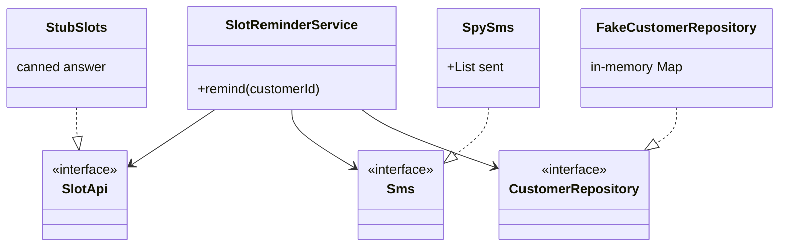
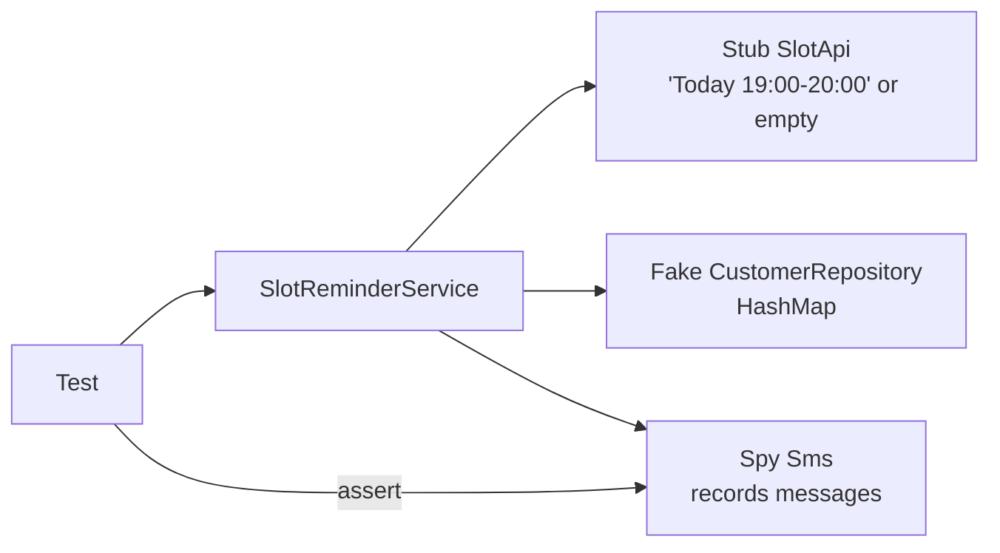
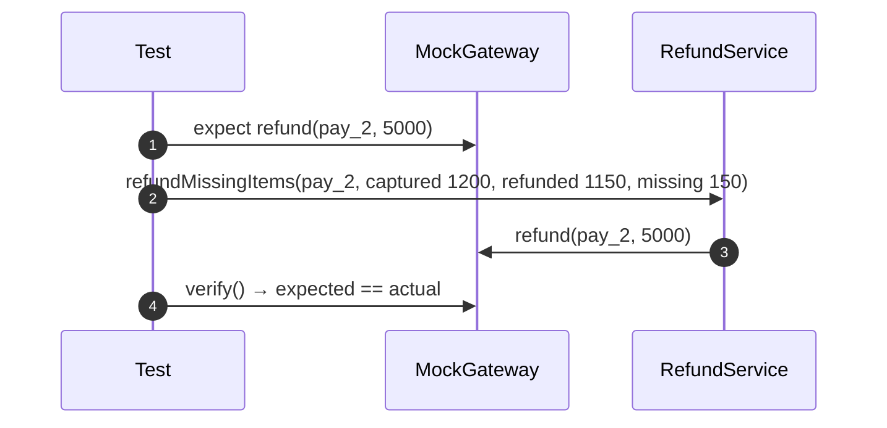
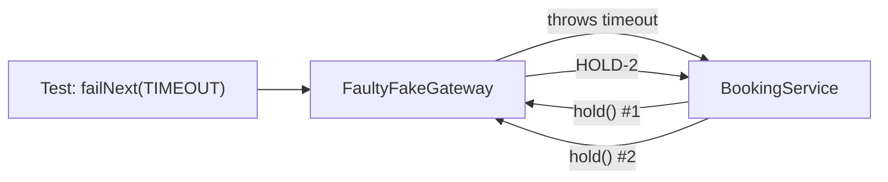

---
tags:
  - Testing
  - Beginner
---

# Test Doubles (Dummy, Stub, Spy, Mock, Fake)

<span class="badge badge--beginner">🟢 Beginner → 🟡 Intermediate</span>
<span class="badge badge--category">Testing</span>
<span class="badge badge--interview">Interview frequency ⭐⭐⭐⭐⭐</span>

!!! abstract "TL;DR"
    **A test double stands in for a real dependency so a unit test is fast, deterministic and focused. *Dummies* fill parameters, *stubs* return canned answers, *spies* record calls, *mocks* verify expected calls, and *fakes* are working lightweight implementations.**
    Prefer fakes and state-based assertions; use mocks only for side effects you can't observe any other way.

---

## 1. Intent & Problem It Solves

**The problem in plain English:** the slot-reminder service checks a delivery-slot API, looks up the customer in PostgreSQL and sends an SMS. A test that uses the real things is slow, flaky (the slot API changes every minute), costs money (SMS), and can't easily reproduce rare paths like "API timed out twice".

**Definition (Gerard Meszaros, *xUnit Test Patterns*):**
> A Test Double is any object that replaces a real component (the depended-on component, DOC) for testing purposes.

| Double | What it does | Assertion style | Example |
|---|---|---|---|
| **Dummy** | Passed but never used | — | `null` or `new Object()` for an unused parameter |
| **Stub** | Returns canned answers | State (check the result) | Slot API that always returns "Today 19:00" |
| **Spy** | A stub that also records calls | State of the spy | SMS sender that keeps a list of sent messages |
| **Mock** | Pre-programmed expectations, verified at the end | Behaviour (were the right calls made?) | "gateway.refund(pay_2, 5000) exactly once" |
| **Fake** | A working, simplified implementation | State | In-memory repository, fake clock, fake payment gateway |

Martin Fowler calls the two styles **state verification** ("is the outcome right?") and **behaviour verification** ("did it call the right things?").

## 2. Real-World Analogy

!!! example "Film stunt doubles and props"
    A **dummy** is the mannequin thrown off a building. A **stub** is a prop phone that always shows the same text. A **spy** is a hidden camera recording what the actor does. A **mock** is the director with a script checking each line is said in order. A **fake** is a real-but-cheap set: the café works, but it's plywood.

## 3. Structure



| Participant | Responsibility |
|---|---|
| **System under test (SUT)** | The class whose behaviour the test checks |
| **Depended-on components** | Interfaces the SUT uses (inject them: [Dependency Injection](../enterprise/dependency-injection.md)) |
| **Doubles** | Test-only implementations chosen for each dependency |
| **Test** | Arranges doubles, acts on the SUT, asserts on results/state (or verifies calls) |

## 4. Naive Approach (Without the Pattern)

```java
@Test void remindsCustomer() {
    var service = new SlotReminderService(new HttpSlotApi("https://slots.prod"), new TwilioSms(KEY), new JdbcCustomerRepository(prodLikeDb));
    assertThat(service.remind("C1")).startsWith("reminded");   // depends on the real slot calendar right now
}
```

- :material-close-circle:{ style="color:#e53935" } Slow (network, DB) and **flaky** (real data changes).
- :material-close-circle:{ style="color:#e53935" } Side effects (real SMS, real charges).
- :material-close-circle:{ style="color:#e53935" } Rare paths (timeouts, sold out) can't be triggered on demand.

---

## 5. Three Real-World Examples

### Example 1: Stub, Spy and Fake for Slot Reminders (Grocery)

**Scenario:** A grocery app texts customers when a delivery slot opens, but only if they opted in and only when a slot exists. The test stubs the slot API (fixed answer), uses an in-memory fake for customers, and a spy SMS sender to check exactly which messages would have gone out.

**Design:**



**Full Code:**

=== "SlotReminderService.java"

    ```java
    --8<-- "code/testing/src/main/java/com/handbook/testing/doubles/grocery/SlotReminderService.java"
    ```

    1.  A **stub** is often just a lambda returning a fixed value.
    2.  A **spy** records interactions so the test can assert on them afterwards (state of the spy).
    3.  A **fake** really works (save, then find), just without PostgreSQL. Keep fakes honest with [contract tests](contract-testing.md).

=== "DoublesDemo.java"

    ```java
    --8<-- "code/testing/src/main/java/com/handbook/testing/doubles/grocery/DoublesDemo.java"
    ```

**Output:**

```text
--8<-- "code/outputs/testing/doubles/grocery/DoublesDemo.txt"
```

**Why these doubles here:**

- Each double matches what the test needs: answers (stub), observations (spy), behaviour (fake).
- All three business paths are covered deterministically.
- No mocking framework needed: interfaces + constructor injection make hand-rolled doubles trivial.

---

### Example 2: A Mock for Refund Calls (Payments)

**Scenario:** When items are missing from a grocery delivery, the refund service refunds their value, capped at what's still refundable. The only observable effect is a **call** to the payment gateway, so behaviour verification is appropriate: the test sets an expectation and verifies it, including "no call at all" when everything has been refunded already.

**Design:**



**Full Code:**

=== "MockGateway.java"

    ```java
    --8<-- "code/testing/src/main/java/com/handbook/testing/doubles/payments/MockGateway.java"
    ```

    1.  Expectations are declared **before** the action.
    2.  `verify` compares expected and actual calls, exactly what `Mockito.verify(...)` and `verifyNoMoreInteractions(...)` do.

=== "RefundService.java"

    ```java
    --8<-- "code/testing/src/main/java/com/handbook/testing/doubles/payments/RefundService.java"
    ```

=== "MockDemo.java"

    ```java
    --8<-- "code/testing/src/main/java/com/handbook/testing/doubles/payments/MockDemo.java"
    ```

**Output:**

```text
--8<-- "code/outputs/testing/doubles/payments/MockDemo.txt"
```

**Why a mock here:**

- The outcome **is** an outgoing call to an external system: there's no state to inspect.
- "Exactly this call, nothing else" is the business rule (never over-refund).
- With Mockito: `verify(gateway).refund("pay_2", 5_000L); verifyNoMoreInteractions(gateway);`

---

### Example 3: A Fault-Injecting Fake (Travel)

**Scenario:** A hotel-booking service retries timeouts up to 3 times but must **not** retry "sold out". The partner's sandbox never times out on demand. A fake hotel API can be scripted to fail in specific ways, so every retry path gets a fast, deterministic test.

**Design:**



**Full Code:**

=== "FaultyFakeGateway.java"

    ```java
    --8<-- "code/testing/src/main/java/com/handbook/testing/doubles/travel/FaultyFakeGateway.java"
    ```

    1.  **Scripted faults**: the test decides exactly which call fails and how. Combine with a [fake clock](../enterprise/dependency-injection.md) for timeouts and backoff.

=== "BookingService.java"

    ```java
    --8<-- "code/testing/src/main/java/com/handbook/testing/doubles/travel/BookingService.java"
    ```

=== "FaultInjectionDemo.java"

    ```java
    --8<-- "code/testing/src/main/java/com/handbook/testing/doubles/travel/FaultInjectionDemo.java"
    ```

**Output:**

```text
--8<-- "code/outputs/testing/doubles/travel/FaultInjectionDemo.txt"
```

**Why a fake here:**

- Error paths are where production bugs live, and the hardest to reach with real systems.
- The fake keeps state (active holds), so tests can check that nothing leaked.
- One fake serves many tests; mocks would need re-scripting in each.

---

??? example "Unit Tests: `TestDoublesTest.java`"

    ```java
    --8<-- "code/testing/src/test/java/com/handbook/testing/TestDoublesTest.java"
    ```

## 6. Variations & Modern Java Take

=== "Mockito (reference)"

    ```java
    @ExtendWith(MockitoExtension.class)
    class RefundServiceTest {
        @Mock RefundService.Gateway gateway;          // mock
        @InjectMocks RefundService service;

        @Test void capsRefund() {
            service.refundMissingItems("pay_2", 120_000, 115_000, 15_000);
            verify(gateway).refund("pay_2", 5_000L);
            verifyNoMoreInteractions(gateway);
        }
    }
    // stub:  when(slotApi.nextFreeSlot("560034")).thenReturn(Optional.of("Today 19:00"));
    // spy:   ArgumentCaptor<String> text = ArgumentCaptor.forClass(String.class); verify(sms).send(eq(phone), text.capture());
    ```

| Variation | Notes |
|---|---|
| **Lambdas as stubs** | Single-method interfaces make stubs one-liners (`pincode -> Optional.of("19:00")`) |
| **Mockito** | `mock`, `when/thenReturn`, `verify`, `ArgumentCaptor`, `spy(realObject)` (partial mock) |
| **Spring Boot** | `@MockitoBean` replaces a bean in the test context (Boot 3.4+; replaced `@MockBean`) |
| **WireMock / MockServer** | HTTP-level stubs and fault injection for clients |
| **Testcontainers** | Real infrastructure (PostgreSQL, Kafka) instead of fakes for integration tests |
| **Fake clocks / ids** | `Clock.fixed`, seeded `Random`, injected id generators for determinism |

## 7. Where It Lives in Real Frameworks

| Where | Test doubles |
|---|---|
| Mockito / EasyMock / MockK | Mocks, stubs, spies, argument captors |
| Spring | `@MockitoBean`, `@MockitoSpyBean`, `MockMvc`, `MockRestServiceServer` (HTTP client stub) |
| JDK | `java.time.Clock.fixed`, `Clock.offset`; `HttpClient` can be wrapped behind an interface |
| HTTP | WireMock, MockWebServer (OkHttp) |
| Data | H2 / embedded Kafka as fakes; Testcontainers for the real thing |

## 8. Pros, Cons & Trade-offs

| ✅ Pros | ❌ Cons |
|---|---|
| Fast, deterministic, isolated unit tests | Doubles can drift from real behaviour |
| Any path (errors, timeouts) can be tested on demand | Over-mocking couples tests to implementation details |
| No side effects or costs | Mock-heavy tests are hard to read |
| Forces good design (interfaces, DI) | False confidence if integration tests are missing |

## 9. Pitfalls & Anti-Patterns

!!! danger "Mocking everything"
    Verifying every internal call makes tests fail on harmless refactors (coding challenge) and pass on broken behaviour. Assert outcomes; mock only true external side effects.

!!! danger "Mocking types you don't own"
    Mocking `RestTemplate`, `JdbcTemplate` or an SDK encodes your *assumptions* about it. Wrap third-party APIs behind your own interface (an adapter) and double that; test the adapter against the real thing.

!!! warning "Fakes without contract tests"
    An in-memory repository that behaves differently from PostgreSQL (no unique constraints, no copies) hides bugs. Run the same contract test suite against fake and real ([Repository](../enterprise/repository.md)).

!!! warning "Partial mocks (spies on real objects)"
    `spy(realService)` with some methods stubbed usually means the class does too much. Split it instead.

## 10. Senior / Architect Deep Dive (10–15 yrs)

**The test pyramid in practice.** Many fast unit tests with stubs/fakes; fewer integration tests with Testcontainers for adapters (DB, Kafka, HTTP clients); a thin layer of contract tests between services; very few end-to-end tests. Doubles live at the **ports** of a hexagonal service; adapters are tested against real infrastructure.

**London vs Chicago schools.** "Mockist" (London) TDD mocks collaborators and drives design through interactions; "classicist" (Chicago) uses real objects and fakes and asserts state. Most robust codebases lean classicist for domain logic and mockist only at boundaries with side effects.

**Determinism.** Flaky tests usually come from hidden dependencies: time, randomness, threads, network, ordering of `HashMap`. Inject them and replace with doubles: `Clock.fixed`, seeded `Random`, synchronous executors.

!!! bug "War story: green tests, broken refunds"
    A payments team's refund tests mocked `RestTemplate` and asserted it was called with a URL. The PSP changed its API to require an idempotency header; the mocks didn't care, tests stayed green, and production refunds failed for six hours.
    **Fix:** a `PspClient` adapter interface with fakes for unit tests; the adapter itself tested against WireMock recordings and the PSP sandbox; a contract test in CI.
    **Lesson:** don't mock what you don't own. Wrap it, then double your wrapper.

## 11. Related Patterns & Comparisons

| | Fake | Stub | Mock | Real (Testcontainers) |
|---|---|---|---|---|
| Has logic | Yes (simplified) | No | Expectations only | Full |
| Speed | Very fast | Fastest | Fast | Seconds |
| Best for | Repositories, clocks, gateways | Fixed inputs | Verifying side-effect calls | Adapter/integration tests |
| Drift risk | Medium (use contract tests) | Low | High (encodes assumptions) | None |

Related: [Dependency Injection](../enterprise/dependency-injection.md) makes doubles possible; [Contract Testing](contract-testing.md) keeps them honest; [Test Data Builder](test-data-builder.md) makes inputs readable.

## 12. Interview Corner

=== "🟢 Beginner / Service Companies"

    **Q1. What is a mock?**

    A test double with expectations about how it will be called, verified at the end of the test.

    **Q2. Stub vs mock?**

    A stub returns canned data (you check the result); a mock checks the calls made to it.

    **Q3. What is a fake?**

    A working simplified implementation, like an in-memory repository.

    **Q4. What do `@Mock` and `@InjectMocks` do?**

    `@Mock` creates a Mockito mock; `@InjectMocks` creates the class under test and injects the mocks into it.

    **Q5. Why use test doubles?**

    Speed, isolation, determinism, and the ability to test error paths without side effects.

=== "🟡 Mid-Level"

    **Q1. When should you use a mock vs a fake?**

    Mock when the only observable effect is a call to an external system; fake when the dependency holds state you can inspect.

    **Q2. What does "don't mock what you don't own" mean?**

    Wrap third-party APIs in your own interfaces and double those; test the wrappers against the real thing.

    **Q3. What is `ArgumentCaptor` for?**

    Capturing arguments passed to a mock so you can assert on them in detail.

    **Q4. Why are over-mocked tests brittle?**

    They encode implementation details (call order, internal methods), so refactors break them even when behaviour is unchanged.

    **Q5. `@MockitoBean` vs `@Mock`?**

    `@MockitoBean` replaces a bean in the Spring context (slower, integration-style); `@Mock` is plain Mockito with no Spring.

=== "🔴 Senior / FAANG / SAP"

    **Q1. "How do you keep fakes trustworthy?"**

    Shared contract test suites run against the fake and the real adapter (Testcontainers), and consumer-driven contracts for remote services.

    **Q2. "Design the test strategy for a hexagonal payments service."**

    Domain: pure unit tests, no doubles needed. Application: fakes for repositories, mocks for outbound side effects. Adapters: Testcontainers / WireMock. Between services: contract tests. A few E2E smoke tests.

    **Q3. "How do you test retry and timeout logic deterministically?"**

    Fault-injecting fakes plus a fake clock/scheduler; never real sleeps.

    **Q4. "A test suite takes 40 minutes. Where do doubles help?"**

    Replace Spring-context and network-heavy tests with plain unit tests on fakes; keep a small integration layer; parallelize.

    **Q5. "London vs Chicago school?"**

    Mockist vs classicist; prefer classicist for domain logic (refactor-friendly), mockist at side-effect boundaries.

=== "💻 Coding Challenge"

    **Problem:** A restock routine is refactored from two `save()` calls to one `saveAll()`. Show that an interaction-based test fails while a state-based test with a fake passes, even though behaviour didn't change.

    ??? success "Solution"

        === "OverMockingDemo.java"

            ```java
            --8<-- "code/testing/src/main/java/com/handbook/testing/doubles/overmocking/OverMockingDemo.java"
            ```

        **Output:**

        ```text
        --8<-- "code/outputs/testing/doubles/overmocking/OverMockingDemo.txt"
        ```

        **Key points to say:** the interaction test verified *how* the code worked, not *what* it achieved. A fake with state lets the test assert the outcome (stock levels), so refactors stay green and real regressions still fail.

!!! info "Behavioural tie-in (STAR) for experienced candidates"
    - **S:** Refund tests mocked `RestTemplate`, so an upstream API change broke production refunds while CI stayed green.
    - **T:** Make the test suite catch integration breakages without slowing it down.
    - **A:** Introduced adapter interfaces with fakes for unit tests, WireMock-based adapter tests, contract tests against the PSP sandbox, and banned mocking third-party types via a review checklist.
    - **R:** Two later API changes were caught in CI; unit tests got 3× faster after removing Spring contexts from them.

## 13. Quick Revision Card

!!! tip "Remember in 30 seconds"
    - **Dummy** fills, **stub** answers, **spy** records, **mock** verifies, **fake** works.
    - Prefer **state** assertions with fakes; mock only external side effects.
    - Don't mock what you don't own: wrap it.
    - Inject time, randomness and I/O to make tests deterministic.
    - Keep fakes honest with contract tests.

    ```java
    SlotApi stub = pincode -> Optional.of("Today 19:00");   // a stub is often just a lambda
    ```

## Practice

- [ ] Rewrite `MockDemo` with Mockito (`verify`, `verifyNoMoreInteractions`).
- [ ] Add a `Fault.SLOW` to `FaultyFakeGateway` and test a timeout with a fake clock.
- [ ] Write a contract test that runs against `FakeCustomerRepository` and a JDBC version.

---

[:material-arrow-left: Testing Patterns](index.md){ .md-button }
[Next: Contract Testing :material-arrow-right:](contract-testing.md){ .md-button .md-button--primary }
